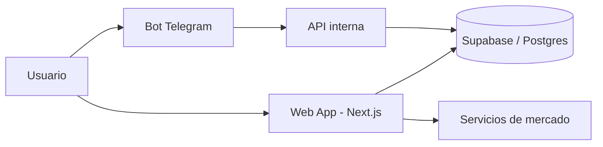
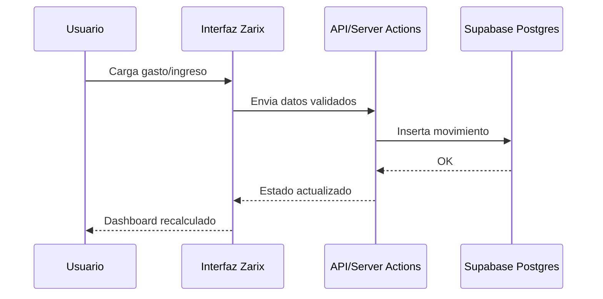

# Zarix

Estado técnico del 09/10/2026: [correcciones, evidencia y bloqueos de verificación aislada](docs/tif/v2.13/VERIFICACION-TECNICA-20261009.md). Entrega parcial en borrador; la aceptación UI/API/Auth y proveedores reales sigue pendiente.

Zarix es una app de finanzas personales para uso individual, enfocada en Argentina.

> Control simple, rapido y visual de tu dinero en un solo lugar.

## Indice

- [Que es Zarix](#que-es-zarix)
- [Secciones principales](#secciones-principales)
- [Stack tecnologico](#stack-tecnologico)
- [Arquitectura y flujo](#arquitectura-y-flujo)
- [Instalacion local](#instalacion-local)
- [Variables de entorno](#variables-de-entorno)
- [Testing](#testing)
- [CI](#ci)
- [Buenas practicas de seguridad](#buenas-practicas-de-seguridad)
- [FAQ](#faq)
- [Auditoria y handoff](#auditoria-y-handoff)

## Que es Zarix

La web de Zarix te permite:

- ver tu patrimonio y saldos en un dashboard claro,
- registrar y editar movimientos,
- administrar cuentas y categorias,
- seguir inversiones,
- consultar cotizaciones y mercados,
- dividir gastos con amigos (grupos compartidos estilo Tricount),
- importar y exportar tus datos.

## Secciones principales

### Dashboard
- Resumen de patrimonio liquido y total, con rendimiento real vs IPC, MEP, CCL y benchmarks (sin recomendar inversiones).
- Cotizaciones de dolar y crypto.
- Ultimos movimientos.
- Estado general de tarjetas, con resumen proyectado por cierre, cuotas pendientes y deuda futura en ARS/USD.

### Movimientos
- Alta, edicion y eliminacion de gastos/ingresos/transferencias.
- Filtros por fecha, cuenta, categoria y tipo.

### Cuentas
- Gestion de cuentas (banco, efectivo, tarjetas, billeteras, inversiones).
- Soporte de tarjetas bi-moneda.
- Saldos negativos permitidos.

### Inversiones
- Portafolio con posiciones y P&L.
- Vista de mercado para USA y Merval.

### Analisis
- Graficos de gastos por categoria.
- Tendencia mensual.
- Flujo de caja.
- Top de gastos para detectar desbalances.

### Presupuestos y recurrentes
- Presupuestos por categoria.
- Reglas de movimientos recurrentes.

### Gastos compartidos
- Grupos para dividir gastos entre varias personas (viajes, asados, hogar).
- Los invitados NO necesitan cuenta: entran con un link e indican nombre + email o telefono.
- Cada gasto registra quien pago y entre quienes se divide (partes iguales).
- Saldos por persona y sugerencia de pagos para saldar cuentas (quien le paga a quien).

### Configuracion
- Preferencias de usuario.
- Importacion y exportacion de datos (CSV/JSON/backup).

## Stack tecnologico

- **Frontend**: Next.js 15.5.27, React 18, Tailwind CSS, Recharts.
- **Backend/Data**: Supabase (PostgreSQL + Auth + APIs).
- **Automatizaciones**: Telegram Bot (Telegraf), scripts Node/TS.
- **Integraciones**: cotizaciones y mercado (Yahoo Finance y fuentes externas).
- **Validacion**: Zod. Estado de UI local (`useState`); Server Components para datos. No hay store global.

## Arquitectura y flujo

### Vista general



### Flujo simplificado de un movimiento



### Mapa funcional rapido

```text
Zarix
├── Dashboard
├── Movimientos
├── Cuentas y Tarjetas
├── Inversiones
├── Analisis
├── Gastos compartidos (publico via link)
└── Import / Export
```

## Instalacion local

### 1) Requisitos

- Node.js >=22 y <25 (CI: Node 22)
- npm 9+
- Proyecto Supabase configurado

### 2) Levantar el proyecto

```bash
npm install
npm run dev
```

### 3) Scripts utiles

```bash
npm run build            # build de produccion
npm run lint             # chequeo de codigo
npm run db:push          # aplica cambios de DB en Supabase
npm run db:reset         # resetea DB local/sandbox
npm run telegram:webhook # configura webhook de Telegram
```

## Variables de entorno

Todas las variables estan documentadas en [`.env.example`](./.env.example) (placeholders,
sin valores reales). Copia ese archivo a `.env.local` y completa los valores.

**Produccion:** `NEXT_PUBLIC_APP_URL` tiene que ser la origin publica (hoy
`https://zarix-phi.vercel.app`). Sin ella, `/auth/callback` falla y los metadatos
OG apuntan a localhost. Ver `docs/AUDIT.md`.

Grupos:

- **Supabase** (requeridas): `NEXT_PUBLIC_SUPABASE_URL`,
  `NEXT_PUBLIC_SUPABASE_ANON_KEY` (ambas expuestas al cliente, el acceso lo
  limita RLS) y `SUPABASE_SERVICE_ROLE_KEY` (solo server, secreta).
- **Telegram** (requeridas para el bot): `TELEGRAM_BOT_TOKEN`,
  `TELEGRAM_WEBHOOK_SECRET`.
- **Google Gemini** (opcional, con BYO-key por usuario): `GEMINI_API_KEY`
  (fallback del server), `GEMINI_MODEL_FULL`, `GEMINI_MODEL_LITE`.
- **Mercado Pago / billing** (requeridas para cobrar): `MP_ACCESS_TOKEN`,
  `MP_WEBHOOK_SECRET` y los `MP_SUBSCRIPTION_*` / `MP_API_BASE_URL` (opcionales,
  con defaults).
- **Datos de mercado** (opcionales, tienen default): `DOLARAPI_URL`,
  `CRIPTOYA_API_URL`, `COINGECKO_API_URL`, `EXCHANGE_RATE_CACHE_TTL`. Yahoo
  Finance y Stooq no necesitan key.
- **App / ops**: `CRON_SECRET` (requerida en prod: sin ella los `/api/cron/*`
  quedan cerrados), `DEV_LOGIN_SECRET` + `ALLOW_DEV_LOGIN` (login de desarrollo),
  `NEXT_PUBLIC_APP_URL`, `COMPARE_USER_ID`.
- **Inbound email** (opcional): `INBOUND_EMAIL_WEBHOOK_SECRET`,
  `INBOUND_EMAIL_DOMAIN`. Sin el secreto, `POST /api/ingest/email` queda en 503.
  No se crea la cuenta del proveedor (Resend u otro) desde el repo.

> Las variables `NEXT_PUBLIC_*` se exponen en el bundle del navegador: nunca
> pongas secretos ahi.

## Testing

Los tests corren con **Vitest**:

```bash
npm test
```

La suite sigue una estrategia **basada en riesgo** (ver `docs/adr/0005-...`):
se prioriza la logica monetaria pura (calculo de saldos, waterfall multi-moneda,
settlements de gastos compartidos) por sobre una piramide de tests completa,
razonable para un proyecto unipersonal. `npm run test:bot` sigue disponible como
smoke test manual del flujo de Telegram.

## CI

Hay integracion continua con **GitHub Actions**: en cada push y pull request se
ejecuta lint + typecheck + tests + build. Un PR no se mergea con esos checks en
rojo.

## Buenas practicas de seguridad

Para compartir este repositorio o mostrarlo publicamente sin comprometer tus datos:

- No subir secretos a Git (`.env`, tokens, claves privadas, credenciales de bot).
- Usar variables de entorno para keys y URLs sensibles.
- Nunca hardcodear IDs de cuentas reales, usuarios reales ni movimientos reales.
- Anonimizar cualquier CSV/JSON de ejemplo antes de compartirlo.
- Mantener politicas de acceso en Supabase (Auth + RLS cuando aplique).
- Revisar logs y scripts para evitar `console.log` con informacion sensible.
- Definir `CRON_SECRET` en produccion: sin valor, los endpoints `/api/cron/*` quedan cerrados (no usar `Bearer undefined`).
- El login de desarrollo (`/api/auth/dev-login`) en produccion responde 404 salvo que configures explicitamente `ALLOW_DEV_LOGIN=true` (solo si lo necesitas y con `DEV_LOGIN_SECRET` fuerte).

> Los placeholders viven en `.env.example` (trackeado). `.env.local` no se sube.

## Funcionalidad base

- Registro manual en web.
- Soporte de carga por bot de Telegram (texto, voz y foto de tickets).
- Bot con consultas y altas de recurrentes por lenguaje natural.
- Parseo de tickets por imagen (con confirmacion).
- Multi-moneda: ARS, USD, USDT, BTC, ETH.
- Gastos compartidos con acceso por link (sin cuenta para invitados).

## FAQ

### Para quien esta pensada Zarix?
Para una persona que quiere controlar sus finanzas de forma simple y rapida.

### Puedo usarla desde celular?
Si, esta optimizada para mobile y se puede usar como PWA.

### Puedo importar movimientos que ya tengo?
Si, podes importar desde CSV o JSON.

### Puedo exportar mi informacion?
Sí, podés exportar transacciones y cinco tablas de datos personales. Esa exportación no restaura el esquema, Auth ni Storage; ver el procedimiento técnico de recuperación.

### Tiene soporte para inversiones?
Si, incluye portafolio y seguimiento de rendimiento.

## Auditoria y handoff

- [`docs/AUDIT.md`](./docs/AUDIT.md) — arquitectura, que anda en prod vs que esta roto, P0/P1/P2, slice recomendado.
- [`docs/HANDOFF.md`](./docs/HANDOFF.md) — como seguir (env, mapa de codigo, Definition of Done del slice Trust).


## Trabajo Final de Ingeniería

El plan v2.13 y la evidencia de esta revisión están en [docs/tif/v2.13](docs/tif/v2.13/README.md). El alcance académico final tiene exactamente cuatro casos de uso; los diagramas y resultados anteriores conservan su carácter histórico.
