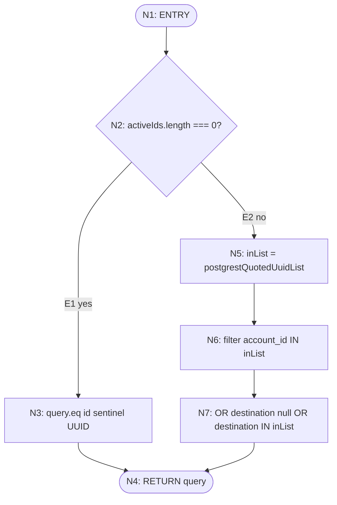
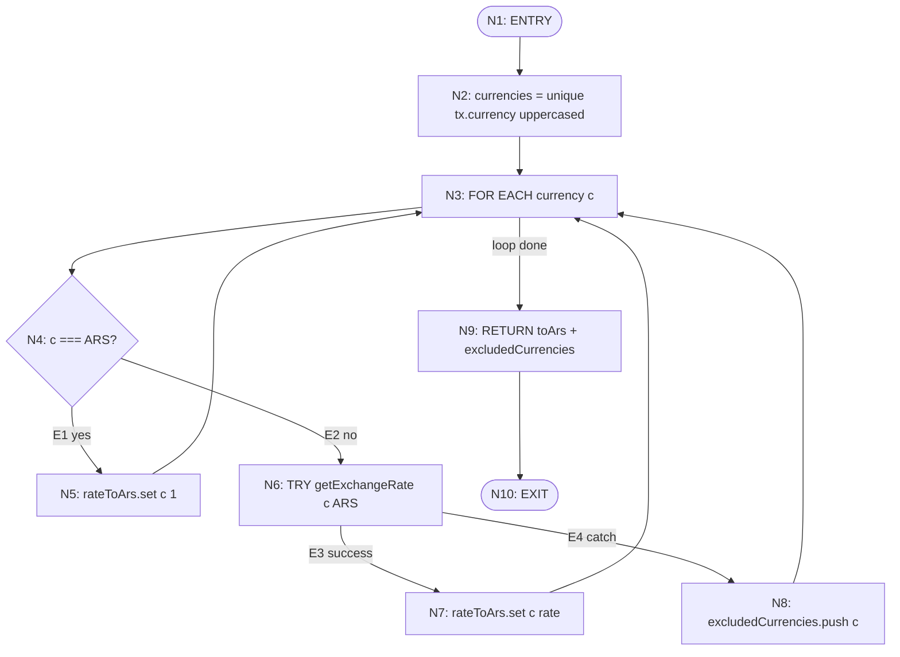
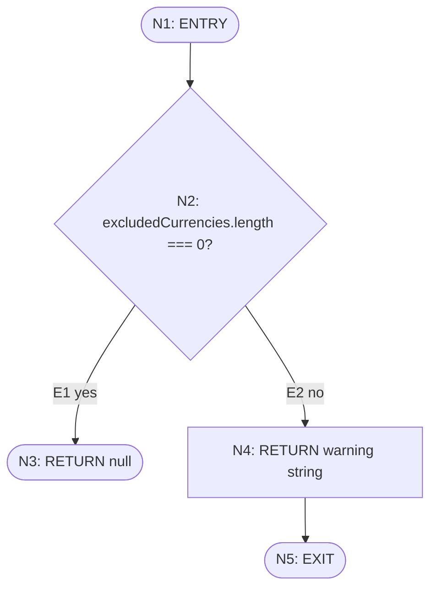
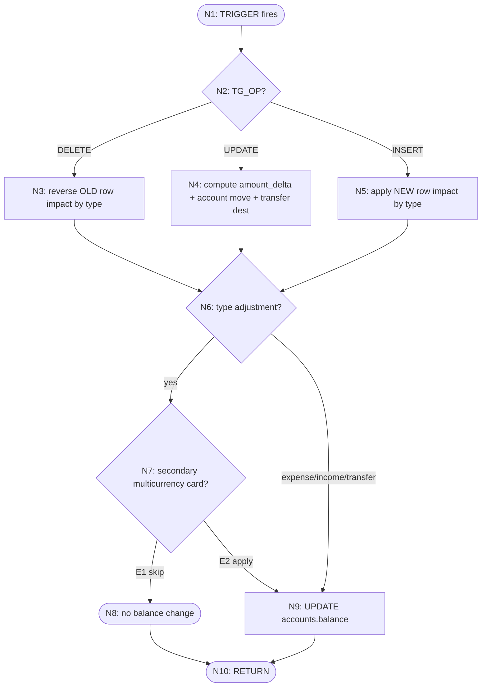
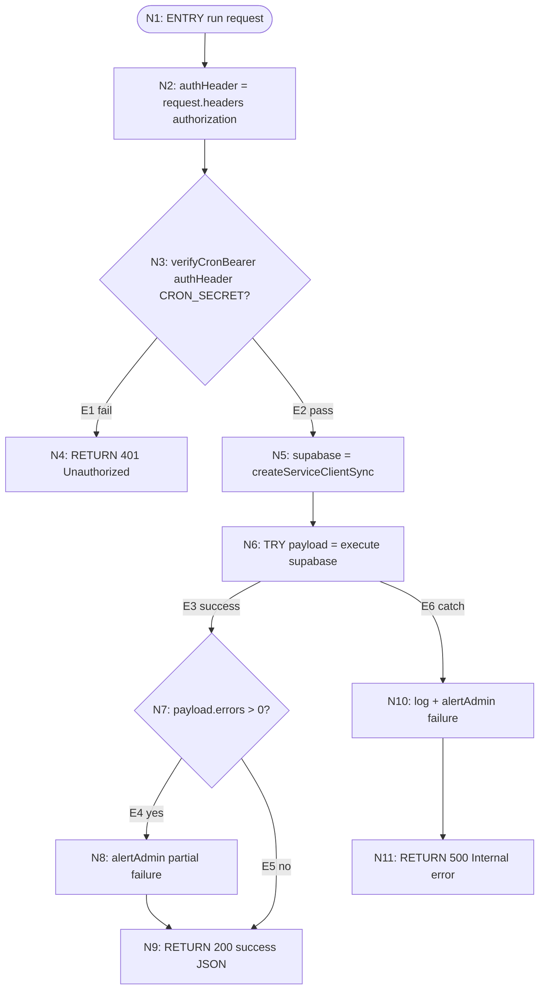
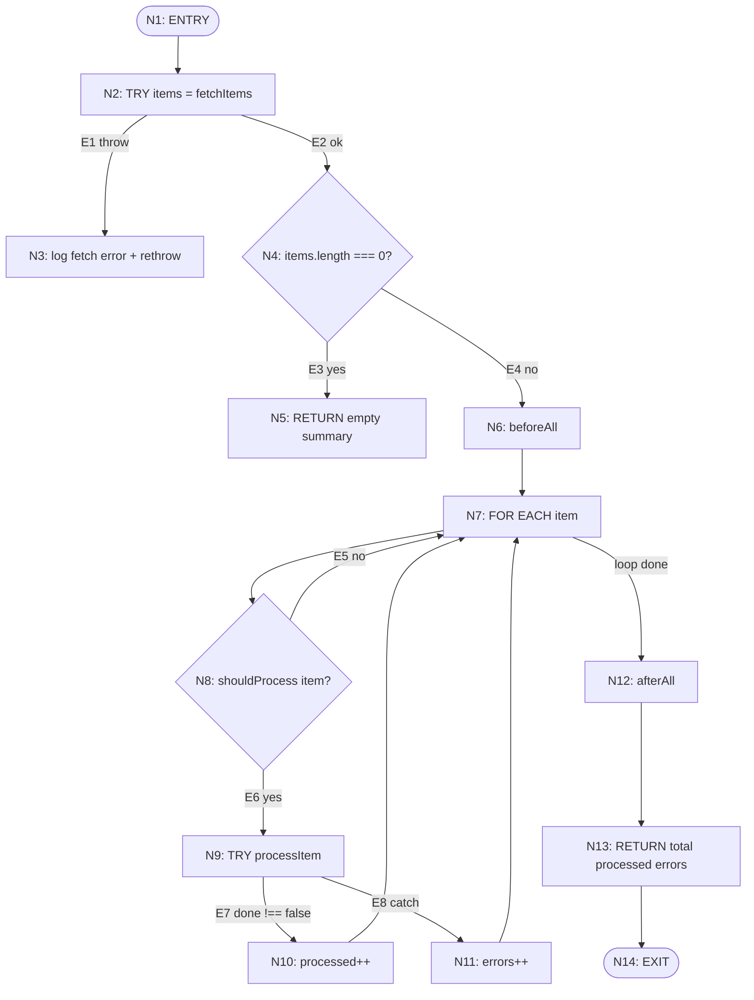
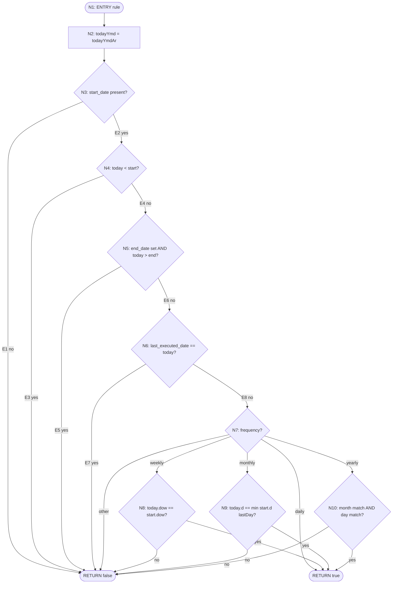

# Export de evidencia de testing estructural (para tesis)

Compilación **solo lectura** de fuentes ya presentes en el repo `jeffreydtz/zarix`.
No se inventan números, SHAs ni resultados de corridas. Este archivo **inlinea el contenido completo** de cada fuente encontrada.

- **Repo:** `jeffreydtz/zarix`
- **PR de origen de la evidencia estructural:** [#7](https://github.com/jeffreydtz/zarix/pull/7) — *SAP-TFI structural testing evidence (CU-001, CU-006)*
- **Commit único de PR #7 (head):** `f4874c6e56964bab9e689c924e2c3e13a46d60c7`
- **Merge de PR #7 en main:** `068ab83dbf96687b8e095457c62e24cdb65835bb`
- **HEAD de main al armar este export:** `5cbd7ac984782b5f50e19f72ba7e0c3c8b5304fd`
- **Árbol `docs/testing/`:** idéntico entre el head de PR #7 y HEAD de main (tree `ca0dd199e50c225732fceae57a074ccdc4bc096e`)

Los SHA de blob de cada archivo son los de `git ls-tree` sobre HEAD de main (iguales a PR #7 para `docs/testing/**`).

---

## 0. Índice de rutas y SHAs

| Ruta | Blob SHA (HEAD) | Estado | Notas |
|------|-----------------|--------|-------|
| `docs/testing/cu-001-cfg.md` | `41e5439ab21cca96beaed5fda9ff5eb6ec1000d1` | **PRESENTE** | fuente primaria `docs/testing` o buscada |
| `docs/testing/cu-006-cfg.md` | `05bef01ef1b3e87ac170362b8feb2c417ae2dbcb` | **PRESENTE** | fuente primaria `docs/testing` o buscada |
| `docs/testing/coverage-criterion.md` | `548b3b53571edc9265148ef8455f67107aff2b36` | **PRESENTE** | fuente primaria `docs/testing` o buscada |
| `docs/testing/test-cfg-mapping.md` | `67690245a2ab7db25fcb2201e055cd5664ed580f` | **PRESENTE** | fuente primaria `docs/testing` o buscada |
| `docs/testing/coverage-run-output.txt` | `ca048e4845a166eda7f07a153783757815cfbcaf` | **PRESENTE** | fuente primaria `docs/testing` o buscada |
| `docs/testing/README.md` | `e0a17143bc26d694db0d58bf35c9a55bf84f3be8` | **PRESENTE** | fuente primaria `docs/testing` o buscada |
| `docs/testing/lcov.info` | `37041ce9e232bc4b2bd4d41e144dbfc0358b7d42` | **PRESENTE** | fuente primaria `docs/testing` o buscada |
| `coverage/index.html` | `—` | **FALTA FUENTE** | no está versionado en el repo |
| `coverage/lcov.info` | `—` | **FALTA FUENTE** | no está versionado en el repo |
| `docs/testing/coverage.html` | `—` | **FALTA FUENTE** | no está versionado en el repo |
| `docs/testing/coverage-summary.json` | `—` | **FALTA FUENTE** | no está versionado en el repo |
| `docs/adr/0005-estrategia-testing-risk-based.md` | `e71edf45ceb976198f1b29e868c0a09d4e9b3496` | **PRESENTE** | fuente relacionada citada / de PR #7 |
| `docs/tif/RESULTADOS-PRUEBAS.md` | `986bf53b9e9f099cc8272f326fd0f9c12009aa3f` | **PRESENTE** | fuente relacionada citada / de PR #7 |
| `vitest.config.ts` | `d93af9126a773081f15a3a9270f03b59b350fe3a` | **PRESENTE** | fuente relacionada citada / de PR #7 |
| `__tests__/transactions-structural.test.ts` | `eda174f1432df5e77becf4329637469fb1eb105b` | **PRESENTE** | fuente relacionada citada / de PR #7 |
| `__tests__/cron-job-structural.test.ts` | `aba50542a30ebe0d4a0d33fa46d8933201de83d7` | **PRESENTE** | fuente relacionada citada / de PR #7 |
| `__tests__/recurring-schedule.test.ts` | `9e6c9b4b440d5e8733fab28956c248f3c721fa81` | **PRESENTE** | fuente relacionada citada / de PR #7 |
| `package.json` | `1fcd2b394878fe0473d751fcec0442212fa170a9` | **PRESENTE** | scripts `test` / `test:coverage` (no se inlinea el JSON completo; ver §1) |

### Archivos `docs/testing/**` presentes

Todos los artefactos versionados bajo `docs/testing/` al HEAD actual:

- `docs/testing/README.md`
- `docs/testing/cu-001-cfg.md`
- `docs/testing/cu-006-cfg.md`
- `docs/testing/coverage-criterion.md`
- `docs/testing/test-cfg-mapping.md`
- `docs/testing/coverage-run-output.txt`
- `docs/testing/lcov.info`

Ningún otro archivo existe bajo `docs/testing/` (salvo este export).

---

## 1. Datos de la corrida Vitest **ya registrados** (no recalculados)

La salida de coverage **no imprime un git SHA**. Lo que sí está registrado:

| Campo | Valor **tal como figura en las fuentes** | Fuente |
|-------|------------------------------------------|--------|
| Comando npm | `npm run test:coverage` | `docs/testing/README.md`; `docs/testing/coverage-run-output.txt` línea 2 |
| Comando efectivo | `vitest run --coverage` | `docs/testing/coverage-run-output.txt` línea 3; `package.json` script `test:coverage` |
| Comando suite completa | `npm test` → `vitest run` | `docs/testing/README.md`; `package.json` script `test` |
| Vitest (banner de la corrida) | `v2.1.9` | `docs/testing/coverage-run-output.txt` (`RUN  v2.1.9 /workspace`) |
| Provider de coverage | `v8` (`@vitest/coverage-v8` en el criterio) | `coverage-run-output.txt`; `coverage-criterion.md`; `vitest.config.ts` |
| SHA **del commit que versionó** la salida y `lcov.info` | `f4874c6e56964bab9e689c924e2c3e13a46d60c7` | único commit de PR #7; `git log -- docs/testing/` |
| SHA **impreso dentro de** `coverage-run-output.txt` | **no consta** | el archivo no contiene hash git |
| Hora de inicio (en la salida) | `23:34:59` | `coverage-run-output.txt` (`Start at  23:34:59`) |
| Duración | `1.60s` | `coverage-run-output.txt` |
| Test Files | `17 passed (17)` | `coverage-run-output.txt` |
| Tests | `162 passed (162)` | `coverage-run-output.txt`; también `docs/testing/README.md` |
| Statements | `23.27% ( 159/683 )` | `coverage-run-output.txt` Coverage summary |
| Branches | `96.82% ( 61/63 )` | `coverage-run-output.txt` Coverage summary |
| Functions | `46.42% ( 13/28 )` | `coverage-run-output.txt` Coverage summary |
| Lines | `23.27% ( 159/683 )` | `coverage-run-output.txt` Coverage summary |

Desglose por archivo **copiado** de la tabla de `coverage-run-output.txt`:

| File | % Stmts | % Branch | % Funcs | % Lines | Uncovered Line #s |
|------|---------|----------|---------|---------|-------------------|
| All files | 23.27 | 96.82 | 46.42 | 23.27 | |
| `app/api/cron/recurring/route.ts` | 0 | 0 | 0 | 0 | 1-96 |
| `lib/cron/cron-job.ts` | 93.65 | 95.83 | 66.66 | 93.65 | 107-108,118-119 |
| `lib/cron/recurring-schedule.ts` | 100 | 100 | 100 | 100 | |
| `lib/services/transactions.ts` | 10.55 | 100 | 29.41 | 10.55 | …26-639,646-730 (ver salida cruda) |

Los mismos porcentajes de branches aparecen en `coverage-criterion.md` (96.82% / 100% / 95.83% / 100%) y en `test-cfg-mapping.md` (PASS 96.82%; statements 23.27% NOT REQUIRED).

**Alcance de coverage** (`vitest.config.ts`, bloque `test.coverage.include`):

- `lib/services/transactions.ts`
- `lib/cron/cron-job.ts`
- `lib/cron/recurring-schedule.ts`
- `app/api/cron/recurring/route.ts`

HTML de coverage (`coverage/index.html`): **FALTA FUENTE** — el README dice que es local only / gitignored; no está en el repo.

---

## 2. Contenido completo inlined

Cada sección siguiente es una copia literal del archivo indicado. No hay paráfrasis.

---

## Fuente: `docs/testing/README.md`

**Índice del folder de evidencia estructural (test-1…test-4)**

- Blob SHA: `e0a17143bc26d694db0d58bf35c9a55bf84f3be8`
- Commit que introdujo `docs/testing/**` (si aplica): `f4874c6e56964bab9e689c924e2c3e13a46d60c7`

````markdown
# Structural testing evidence (SAP-TFI-2026)

This folder holds **test-1 (CFG)**, **test-2 (coverage criterion)**, **test-3 (suite ↔ criterion mapping)**, and **test-4 (measured coverage)** for the Zarix units referenced in EV-COD (PR#6).

## Unit mapping (verified paths)

| Unit | Declared path | Actual path in repo | Notes |
|------|---------------|---------------------|-------|
| **CU-001** | `lib/services/transactions.ts` | `lib/services/transactions.ts` | Core service for movements |
| **CU-001 (DB)** | `update_account_balance` trigger | `supabase/schema.sql` (lines 449–586) | Postgres trigger on `transactions` |
| **CU-006** | `app/api/cron/recurring/route.ts` | `app/api/cron/recurring/route.ts` | Vercel Cron entrypoint |
| **CU-006** | `lib/cron/cron-job.ts` | `lib/cron/cron-job.ts` | Template Method base classes |
| **CU-006** | — | `lib/cron/recurring-schedule.ts` | Pure scheduling helpers extracted from the recurring route for testability |

## Artifacts

| Checklist item | File |
|----------------|------|
| test-1 CFG | [`cu-001-cfg.md`](./cu-001-cfg.md), [`cu-006-cfg.md`](./cu-006-cfg.md) |
| test-2 Coverage criterion | [`coverage-criterion.md`](./coverage-criterion.md) |
| test-3 Suite ↔ CFG mapping | [`test-cfg-mapping.md`](./test-cfg-mapping.md) |
| test-4 Measured coverage | [`coverage-run-output.txt`](./coverage-run-output.txt), [`lcov.info`](./lcov.info) |

## Running the suite

```bash
npm install
npm test                 # 162 Vitest tests (full repo)
npm run test:coverage    # scoped coverage on CU-001 / CU-006 files (see vitest.config.ts)
```

Coverage HTML (local only, gitignored): open `coverage/index.html` after `npm run test:coverage`.

## Scope note

The existing **132/132** Vitest suite (now **162/162**) covers monetary logic across the repo functionally but did **not** previously include CFG diagrams, an explicit coverage criterion, or a branch-to-test mapping for CU-001 / CU-006. This folder closes that gap without turning Zarix into an ERP/Odoo-style integration test project.
````

---

## Fuente: `docs/testing/cu-001-cfg.md`

**test-1 — CFG CU-001**

- Blob SHA: `41e5439ab21cca96beaed5fda9ff5eb6ec1000d1`
- Commit que introdujo `docs/testing/**` (si aplica): `f4874c6e56964bab9e689c924e2c3e13a46d60c7`

````markdown
# test-1 — CU-001 Control Flow Graphs

**Unit:** CU-001 — Register / list financial movements  
**Primary file:** `lib/services/transactions.ts`  
**Database trigger:** `update_account_balance()` in `supabase/schema.sql`

---

## 1. `applyArchivedAccountsTransactionFilter`

Pure filter applied before global transaction list queries when archived accounts must be excluded.



| Node / edge | Meaning |
|-------------|---------|
| N2 | Decision: no active accounts |
| E1 | Empty active set → impossible id filter (returns zero rows) |
| E2 | Non-empty → include only movements touching active accounts |
| E3 | UUID quoting inside `postgrestQuotedUuidList` (embedded in N5) |

---

## 2. `buildToArsConverter`

Builds a per-transaction ARS converter for dashboard / cron summaries.



---

## 3. `excludedCurrenciesNote`

User-facing note when some currencies lacked a live quote.



---

## 4. `update_account_balance()` (PL/pgSQL)

Postgres trigger maintaining `accounts.balance` on `INSERT | UPDATE | DELETE` of `transactions`. Simplified CFG (top level):



**Evidence type:** schema review + production functional tests CP-001-01/03 (saldo observado antes/después). Not executed by Vitest (requires Postgres).

**Key branches inside DELETE/INSERT arms:**

| Branch | Effect |
|--------|--------|
| `expense` | Debit source account |
| `income` | Credit source account |
| `transfer` | Debit source; credit destination if present |
| `adjustment` + not secondary | Apply signed delta |
| `adjustment` + secondary multicurrency | Skip primary balance (RN tarjeta bimonetaria) |

Full source: `supabase/schema.sql` lines 449–586.
````

---

## Fuente: `docs/testing/cu-006-cfg.md`

**test-1 — CFG CU-006**

- Blob SHA: `05bef01ef1b3e87ac170362b8feb2c417ae2dbcb`
- Commit que introdujo `docs/testing/**` (si aplica): `f4874c6e56964bab9e689c924e2c3e13a46d60c7`

````markdown
# test-1 — CU-006 Control Flow Graphs

**Unit:** CU-006 — Execute recurring rules (Vercel Cron)  
**Files:** `lib/cron/cron-job.ts`, `lib/cron/recurring-schedule.ts`, `app/api/cron/recurring/route.ts`

---

## 1. `CronJob.run` (Template Method)



---

## 2. `IterativeCronJob.execute`

Batch template used by `RecurringRulesJob` and other crons.



---

## 3. `shouldExecuteToday`

Pure scheduler extracted to `lib/cron/recurring-schedule.ts` (used by `RecurringRulesJob.shouldProcess`).



---

## 4. `RecurringRulesJob` (route handler — reference only)

`app/api/cron/recurring/route.ts` wires `GET → RecurringRulesJob.run`. Its `processItem` performs Supabase claim + `transactionsService.create` + optional Telegram DM. **Not unit-tested** (I/O); scheduling branches are covered via §3.
````

---

## Fuente: `docs/testing/coverage-criterion.md`

**test-2 — Criterio de cobertura**

- Blob SHA: `548b3b53571edc9265148ef8455f67107aff2b36`
- Commit que introdujo `docs/testing/**` (si aplica): `f4874c6e56964bab9e689c924e2c3e13a46d60c7`

````markdown
# test-2 — Explicit coverage criterion

## Selected criterion

**Decision / branch coverage ≥ 90%** on the **scoped core functions** documented in the CFG artifacts, measured with Vitest + `@vitest/coverage-v8`.

Rationale (aligned with [ADR-0005](../adr/0005-estrategia-testing-risk-based.md)):

- Zarix is a personal-finance PWA; the highest-risk defects are **wrong branches** (balance deltas, cron auth, recurrence windows), not missing line hits in UI code.
- Branch coverage on small, pure or near-pure functions gives the best signal per test for a solo-maintainer codebase.
- Full statement coverage of `transactionsService.create()` would require heavy Supabase mocking and duplicates production functional evidence ([`docs/tif/RESULTADOS-PRUEBAS.md`](../tif/RESULTADOS-PRUEBAS.md) CP-001-xx).

## In-scope functions

### CU-001 (`lib/services/transactions.ts`)

| Function | Type | CFG doc |
|----------|------|---------|
| `applyArchivedAccountsTransactionFilter` | TS, synchronous | [`cu-001-cfg.md#1`](./cu-001-cfg.md#1-applyarchivedaccountstransactionfilter) |
| `buildToArsConverter` | TS, async | [`cu-001-cfg.md#2`](./cu-001-cfg.md#2-buildtoarsconverter) |
| `excludedCurrenciesNote` | TS, synchronous | [`cu-001-cfg.md#3`](./cu-001-cfg.md#3-excludedcurrenciesnote) |

### CU-001 (database)

| Function | Type | CFG doc | Vitest scope |
|----------|------|---------|--------------|
| `update_account_balance()` | PL/pgSQL trigger | [`cu-001-cfg.md#4`](./cu-001-cfg.md#4-update_account_balance-plpgsql) | **Out of Vitest scope** — evidenced by CP-001 production functional tests and schema review |

### CU-006

| Function | File | CFG doc |
|----------|------|---------|
| `CronJob.run` | `lib/cron/cron-job.ts` | [`cu-006-cfg.md#1`](./cu-006-cfg.md#1-cronjobrun-template-method) |
| `IterativeCronJob.execute` | `lib/cron/cron-job.ts` | [`cu-006-cfg.md#2`](./cu-006-cfg.md#2-iterativecronjobexecute) |
| `shouldExecuteToday` | `lib/cron/recurring-schedule.ts` | [`cu-006-cfg.md#3`](./cu-006-cfg.md#3-shouldexecutetoday) |

`RecurringRulesJob` in `app/api/cron/recurring/route.ts` is **integration-heavy** (Supabase + Telegram). Its scheduling decision is covered indirectly via `shouldExecuteToday` unit tests; the route handler itself is excluded from the branch-coverage gate.

## Pass / fail gate

| Scope | Metric | Target | Latest run |
|-------|--------|--------|------------|
| Scoped TS core functions above | Branch coverage | ≥ 90% | **96.82%** (61/63 branches in included files) |
| `lib/cron/recurring-schedule.ts` | Branch coverage | 100% | **100%** |
| `lib/cron/cron-job.ts` | Branch coverage | ≥ 90% | **95.83%** |
| Tested exports in `lib/services/transactions.ts` | Branch coverage | 100% of executed branches | **100%** (only filter/converter/note paths executed) |

**Not a pass criterion:** total statement coverage of entire `transactions.ts` or `route.ts` files (would require mocking the whole Supabase stack).

## Known uncovered branches (honest list)

See [`test-cfg-mapping.md`](./test-cfg-mapping.md) § “Gaps”.
````

---

## Fuente: `docs/testing/test-cfg-mapping.md`

**test-3 — Mapeo suite ↔ CFG**

- Blob SHA: `67690245a2ab7db25fcb2201e055cd5664ed580f`
- Commit que introdujo `docs/testing/**` (si aplica): `f4874c6e56964bab9e689c924e2c3e13a46d60c7`

````markdown
# test-3 — Test suite ↔ CFG mapping

Maps each Vitest test (existing or new) to CFG nodes, edges, or branches from [`cu-001-cfg.md`](./cu-001-cfg.md) and [`cu-006-cfg.md`](./cu-006-cfg.md).

**Legend:** ✅ covered · ⚠️ partial / indirect · ❌ not covered by Vitest

---

## CU-001 — `lib/services/transactions.ts`

### `applyArchivedAccountsTransactionFilter`

| Test file | Test name | CFG ref | Branch |
|-----------|-----------|---------|--------|
| `__tests__/transactions-structural.test.ts` | returns impossible id filter when there are no active accounts | N2 → E1 → N3 | Empty `activeIds` |
| `__tests__/transactions-structural.test.ts` | filters by active account ids when list is non-empty | N2 → E2 → N5–N7 | Non-empty filter path |
| `__tests__/transactions-structural.test.ts` | quotes UUIDs for PostgREST reserved characters | N5 (E3) | UUID quoting |

### `buildToArsConverter`

| Test file | Test name | CFG ref | Branch |
|-----------|-----------|---------|--------|
| `__tests__/transactions-structural.test.ts` | uses rate 1 for ARS without calling cotizaciones | N4 → E1 | ARS shortcut |
| `__tests__/transactions-structural.test.ts` | converts foreign currency using live rate | N6 → E3 | Successful FX lookup |
| `__tests__/transactions-structural.test.ts` | excludes currencies when rate lookup fails | N6 → E4 | Catch / exclude |
| `__tests__/transactions-structural.test.ts` | defaults null currency to ARS | N9 `toArs` closure | Null currency edge |

### `excludedCurrenciesNote`

| Test file | Test name | CFG ref | Branch |
|-----------|-----------|---------|--------|
| `__tests__/transactions-structural.test.ts` | returns null when no currencies were excluded | N2 → E1 | Empty list |
| `__tests__/transactions-structural.test.ts` | returns warning text when currencies were excluded | N2 → E2 | Non-empty list |

### Related existing tests (functional, not CFG-scoped)

| Test file | Tests | Maps to | Notes |
|-----------|-------|---------|-------|
| `__tests__/transaction-account-impact.test.ts` | 12 | CU-001 balance arithmetic mirror | Exercises `impactInAccountCurrency` used alongside ledger logic |
| `__tests__/transaction-exchange.test.ts` | 14 | CU-001 FX helpers | Supports `computeAmountInAccountCurrencyForAccount` callers |
| `docs/tif/RESULTADOS-PRUEBAS.md` CP-001-01/02/03/04 | Production Puppeteer | `transactionsService.create`, trigger side-effects | Functional evidence; not Vitest |

### `update_account_balance()` (SQL)

| Evidence | CFG ref | Branch |
|----------|---------|--------|
| CP-001-01 gasto ARS | INSERT → expense | Debit source ✅ (production) |
| CP-001-03 transferencia | INSERT → transfer | Source debit + dest credit ✅ (production) |
| Schema review | adjustment + secondary multicurrency | E1 skip ⚠️ (design only, no automated branch hit) |
| — | UPDATE / DELETE arms | ❌ no dedicated automated test |

---

## CU-006 — Cron infrastructure

### `CronJob.run`

| Test file | Test name | CFG ref | Branch |
|-----------|-----------|---------|--------|
| `__tests__/cron-job-structural.test.ts` | returns 401 when bearer is invalid | N3 → E1 | Auth fail |
| `__tests__/cron-job-structural.test.ts` | returns 401 when authorization header is missing | N3 → E1 | Missing header |
| `__tests__/cron-job-structural.test.ts` | returns success payload when execute succeeds | N3 → E2 → N6 → E3 → N7 → E5 → N9 | Happy path |
| `__tests__/cron-job-structural.test.ts` | alerts admin when execute reports errors | N7 → E4 → N8 | Partial failure alert |
| `__tests__/cron-job-structural.test.ts` | returns 500 and alerts admin when execute throws | N6 → E6 → N10–N11 | Fatal error |
| `__tests__/cron-auth.test.ts` | 6 tests | N3 (via `verifyCronBearer`) | Indirect auth branches ✅ |

### `IterativeCronJob.execute`

| Test file | Test name | CFG ref | Branch |
|-----------|-----------|---------|--------|
| `__tests__/cron-job-structural.test.ts` | returns empty summary when fetch yields no items | N4 → E3 → N5 | Empty batch |
| `__tests__/cron-job-structural.test.ts` | skips items filtered by shouldProcess | N8 → E5 | Filter skip |
| `__tests__/cron-job-structural.test.ts` | counts per-item failures without aborting the batch | N9 → E7/E8 | Item error tolerance |
| `__tests__/cron-job-structural.test.ts` | rethrows when fetchItems fails | N2 → E1 → N3 | Fetch failure |

### `shouldExecuteToday`

| Test file | Test name | CFG ref | Branch |
|-----------|-----------|---------|--------|
| `__tests__/recurring-schedule.test.ts` | returns false when start_date is missing | N3 → E1 | No start |
| `__tests__/recurring-schedule.test.ts` | returns false before start_date | N4 → E3 | Before window |
| `__tests__/recurring-schedule.test.ts` | returns false after end_date | N5 → E5 | After window |
| `__tests__/recurring-schedule.test.ts` | returns false when already executed today | N6 → E7 | Idempotency |
| `__tests__/recurring-schedule.test.ts` | returns true for daily frequency inside window | N7 daily → Z2 | Daily |
| `__tests__/recurring-schedule.test.ts` | matches weekly rules on start weekday | N7 weekly → N8 | Weekly match / no-match |
| `__tests__/recurring-schedule.test.ts` | matches monthly rules on target day, clamped | N7 monthly → N9 | Monthly + clamp |
| `__tests__/recurring-schedule.test.ts` | matches yearly rules only in start month | N7 yearly → N10 | Yearly match / no-match |
| `__tests__/recurring-schedule.test.ts` | returns false for unknown frequency | N7 other → Z1 | Unknown freq |
| `__tests__/recurring-schedule.test.ts` | todayYmdAr / ymdParts / lastDayOfMonth | Helper nodes | Date plumbing ✅ |

### `RecurringRulesJob` (`app/api/cron/recurring/route.ts`)

| Concern | Vitest | Notes |
|---------|--------|-------|
| `shouldProcess` (inactive account skip) | ❌ | Would need Supabase mock |
| `processItem` (claim + create + Telegram) | ❌ | Integration; out of structural scope |
| Scheduling decision | ✅ indirect | Via `shouldExecuteToday` tests |

---

## Gaps — CFG branches still without a Vitest test

| Unit | Function / location | Branch | Mitigation |
|------|---------------------|--------|------------|
| CU-001 | `transactionsService.create` | All validation / transfer / installment arms | CP-001 production functional tests |
| CU-001 | `update_account_balance` UPDATE/DELETE | Delta recomputation | Not automated; schema-reviewed |
| CU-001 | `update_account_balance` secondary adjustment skip | E1 skip path | Design + migration review |
| CU-006 | `CronJob` default hooks | `shouldProcess` default true (L107–108), `emptyMessage` default (L118–119) | Base-class defaults; subclasses override in production jobs |
| CU-006 | `IterativeCronJob` | `beforeAll` / `afterAll` non-empty hooks | No production job failure path requires unit test here |
| CU-006 | `RecurringRulesJob.processItem` | Claim race, Telegram notify | Future selective integration test |

---

## Suite vs criterion (test-3 summary)

| Criterion (see [`coverage-criterion.md`](./coverage-criterion.md)) | Result |
|---------------------------------------------------------------------|--------|
| Branch coverage ≥ 90% on scoped TS functions | **PASS** (96.82% on included files) |
| Every documented CFG decision branch for scoped functions has ≥1 mapped test | **PASS** except gaps table above |
| Full-file statement coverage | **NOT REQUIRED** — 23.27% statements reflects large untested `create()` body |
````

---

## Fuente: `docs/testing/coverage-run-output.txt`

**test-4 — Salida registrada de Vitest + coverage**

- Blob SHA: `ca048e4845a166eda7f07a153783757815cfbcaf`
- Commit que introdujo `docs/testing/**` (si aplica): `f4874c6e56964bab9e689c924e2c3e13a46d60c7`

````text

> zarix@0.1.0 test:coverage
> vitest run --coverage

The CJS build of Vite's Node API is deprecated. See https://vite.dev/guide/troubleshooting.html#vite-cjs-node-api-deprecated for more details.

 RUN  v2.1.9 /workspace
      Coverage enabled with v8

 ✓ __tests__/transaction-account-impact.test.ts (12 tests) 4ms
 ✓ __tests__/transaction-exchange.test.ts (14 tests) 4ms
stderr | __tests__/cron-job-structural.test.ts > CU-006 CronJob.run > returns 500 and alerts admin when execute throws (branch B4)
[cron:error-job] error: Error: boom
    at ErrorJob.execute (/workspace/__tests__/cron-job-structural.test.ts:25:11)
    at ErrorJob.run (/workspace/lib/cron/cron-job.ts:33:34)
    at /workspace/__tests__/cron-job-structural.test.ts:110:38
    at file:///workspace/node_modules/@vitest/runner/dist/index.js:146:14
    at file:///workspace/node_modules/@vitest/runner/dist/index.js:533:11
    at runWithTimeout (file:///workspace/node_modules/@vitest/runner/dist/index.js:39:7)
    at runTest (file:///workspace/node_modules/@vitest/runner/dist/index.js:1056:17)
    at processTicksAndRejections (node:internal/process/task_queues:105:5)
    at runSuite (file:///workspace/node_modules/@vitest/runner/dist/index.js:1205:15)
    at runSuite (file:///workspace/node_modules/@vitest/runner/dist/index.js:1205:15)

stderr | __tests__/cron-job-structural.test.ts > CU-006 IterativeCronJob.execute > rethrows when fetchItems fails (branch B4)
[cron:fetch-fail] fetch error: Error: db down
    at FetchFailJob.fetchItems (/workspace/__tests__/cron-job-structural.test.ts:147:15)
    at FetchFailJob.execute (/workspace/lib/cron/cron-job.ts:65:26)
    at /workspace/__tests__/cron-job-structural.test.ts:155:95
    at file:///workspace/node_modules/@vitest/runner/dist/index.js:146:14
    at file:///workspace/node_modules/@vitest/runner/dist/index.js:533:11
    at runWithTimeout (file:///workspace/node_modules/@vitest/runner/dist/index.js:39:7)
    at runTest (file:///workspace/node_modules/@vitest/runner/dist/index.js:1056:17)
    at processTicksAndRejections (node:internal/process/task_queues:105:5)
    at runSuite (file:///workspace/node_modules/@vitest/runner/dist/index.js:1205:15)
    at runSuite (file:///workspace/node_modules/@vitest/runner/dist/index.js:1205:15)

stderr | __tests__/cron-job-structural.test.ts > CU-006 IterativeCronJob.execute > counts per-item failures without aborting the batch (branch B3)
[cron:iterative-test] item error: Error: fail bad
    at TestIterativeJob.processItem (/workspace/__tests__/cron-job-structural.test.ts:54:26)
    at TestIterativeJob.execute (/workspace/lib/cron/cron-job.ts:83:33)
    at processTicksAndRejections (node:internal/process/task_queues:105:5)
    at /workspace/__tests__/cron-job-structural.test.ts:167:20
    at file:///workspace/node_modules/@vitest/runner/dist/index.js:533:5
    at runTest (file:///workspace/node_modules/@vitest/runner/dist/index.js:1056:11)
    at runSuite (file:///workspace/node_modules/@vitest/runner/dist/index.js:1205:15)
    at runSuite (file:///workspace/node_modules/@vitest/runner/dist/index.js:1205:15)
    at runFiles (file:///workspace/node_modules/@vitest/runner/dist/index.js:1262:5)
    at startTests (file:///workspace/node_modules/@vitest/runner/dist/index.js:1271:3)

 ✓ __tests__/cron-job-structural.test.ts (9 tests) 19ms
 ✓ __tests__/billing-plans.test.ts (10 tests) 8ms
 ✓ __tests__/shared-expenses.test.ts (10 tests) 5ms
 ✓ __tests__/transactions-structural.test.ts (9 tests) 5ms
 ✓ __tests__/recurring-schedule.test.ts (12 tests) 17ms
 ✓ __tests__/notification-schedule.test.ts (11 tests) 16ms
 ✓ __tests__/transaction-date.test.ts (14 tests) 4ms
 ✓ __tests__/transaction-currencies.test.ts (5 tests) 3ms
 ✓ __tests__/sanitize-amount-input.test.ts (17 tests) 4ms
 ✓ __tests__/webhook-auth.test.ts (4 tests) 3ms
 ✓ __tests__/secure-compare.test.ts (6 tests) 2ms
 ✓ __tests__/cron-auth.test.ts (6 tests) 2ms
 ✓ __tests__/evaluate-simple-amount-expression.test.ts (18 tests) 4ms
 ✓ __tests__/rate-limit.test.ts (1 test) 2ms
 ✓ __tests__/sanitize-for-prompt.test.ts (4 tests) 3ms

 Test Files  17 passed (17)
      Tests  162 passed (162)
   Start at  23:34:59
   Duration  1.60s (transform 359ms, setup 0ms, collect 905ms, tests 105ms, environment 3ms, prepare 986ms)

 % Coverage report from v8
-------------------|---------|----------|---------|---------|-------------------
File               | % Stmts | % Branch | % Funcs | % Lines | Uncovered Line #s 
-------------------|---------|----------|---------|---------|-------------------
All files          |   23.27 |    96.82 |   46.42 |   23.27 |                   
 ...cron/recurring |       0 |        0 |       0 |       0 |                   
  route.ts         |       0 |        0 |       0 |       0 | 1-96              
 lib/cron          |   96.36 |    97.87 |      80 |   96.36 |                   
  cron-job.ts      |   93.65 |    95.83 |   66.66 |   93.65 | 107-108,118-119   
  ...g-schedule.ts |     100 |      100 |     100 |     100 |                   
 lib/services      |   10.55 |      100 |   29.41 |   10.55 |                   
  transactions.ts  |   10.55 |      100 |   29.41 |   10.55 | ...26-639,646-730 
-------------------|---------|----------|---------|---------|-------------------

=============================== Coverage summary ===============================
Statements   : 23.27% ( 159/683 )
Branches     : 96.82% ( 61/63 )
Functions    : 46.42% ( 13/28 )
Lines        : 23.27% ( 159/683 )
================================================================================
````

---

## Fuente: `docs/testing/lcov.info`

**test-4 — Informe LCOV registrado**

- Blob SHA: `37041ce9e232bc4b2bd4d41e144dbfc0358b7d42`
- Commit que introdujo `docs/testing/**` (si aplica): `f4874c6e56964bab9e689c924e2c3e13a46d60c7`

````lcov
TN:
SF:app/api/cron/recurring/route.ts
FN:1,(empty-report)
FNF:1
FNH:0
FNDA:0,(empty-report)
DA:1,0
DA:7,0
DA:8,0
DA:10,0
DA:11,0
DA:13,0
DA:15,0
DA:16,0
DA:17,0
DA:18,0
DA:20,0
DA:21,0
DA:22,0
DA:24,0
DA:25,0
DA:29,0
DA:31,0
DA:32,0
DA:34,0
DA:38,0
DA:39,0
DA:40,0
DA:41,0
DA:42,0
DA:43,0
DA:44,0
DA:45,0
DA:46,0
DA:47,0
DA:49,0
DA:50,0
DA:51,0
DA:52,0
DA:53,0
DA:54,0
DA:55,0
DA:56,0
DA:57,0
DA:58,0
DA:59,0
DA:60,0
DA:63,0
DA:64,0
DA:65,0
DA:66,0
DA:67,0
DA:69,0
DA:70,0
DA:71,0
DA:72,0
DA:73,0
DA:74,0
DA:75,0
DA:76,0
DA:77,0
DA:79,0
DA:80,0
DA:81,0
DA:82,0
DA:83,0
DA:84,0
DA:85,0
DA:86,0
DA:87,0
DA:89,0
DA:90,0
DA:91,0
DA:92,0
DA:94,0
DA:95,0
DA:96,0
LF:71
LH:0
BRDA:1,0,0,0
BRF:1
BRH:0
end_of_record
TN:
SF:lib/cron/cron-job.ts
FN:24,run
FN:62,execute
FN:106,shouldProcess
FN:111,beforeAll
FN:114,afterAll
FN:117,emptyMessage
FNF:6
FNH:4
FNDA:5,run
FNDA:4,execute
FNDA:0,shouldProcess
FNDA:2,beforeAll
FNDA:2,afterAll
FNDA:0,emptyMessage
DA:1,1
DA:19,1
DA:24,1
DA:25,5
DA:26,5
DA:27,2
DA:28,2
DA:30,3
DA:32,3
DA:33,3
DA:36,5
DA:37,5
DA:38,1
DA:39,1
DA:40,1
DA:41,1
DA:42,2
DA:43,5
DA:44,1
DA:45,1
DA:46,1
DA:47,1
DA:48,1
DA:49,1
DA:50,5
DA:54,1
DA:61,1
DA:62,1
DA:63,4
DA:64,4
DA:65,4
DA:66,4
DA:67,1
DA:68,1
DA:69,1
DA:71,4
DA:72,1
DA:73,1
DA:75,2
DA:77,2
DA:78,2
DA:80,4
DA:81,5
DA:82,4
DA:83,4
DA:84,3
DA:85,5
DA:86,1
DA:87,1
DA:88,1
DA:89,5
DA:91,2
DA:93,2
DA:94,4
DA:106,1
DA:107,0
DA:108,0
DA:111,1
DA:114,1
DA:117,1
DA:118,0
DA:119,0
DA:120,1
LF:63
LH:59
BRDA:24,0,0,5
BRDA:26,1,0,2
BRDA:28,2,0,3
BRDA:33,3,0,2
BRDA:36,4,0,1
BRDA:37,5,0,1
BRDA:41,6,0,2
BRDA:43,7,0,1
BRDA:46,8,0,0
BRDA:62,9,0,4
BRDA:65,10,0,3
BRDA:66,11,0,1
BRDA:69,12,0,3
BRDA:71,13,0,1
BRDA:73,14,0,2
BRDA:80,15,0,5
BRDA:81,16,0,1
BRDA:81,17,0,4
BRDA:83,18,0,3
BRDA:84,19,0,2
BRDA:85,20,0,1
BRDA:89,21,0,2
BRDA:111,22,0,2
BRDA:114,23,0,2
BRF:24
BRH:23
end_of_record
TN:
SF:lib/cron/recurring-schedule.ts
FN:3,todayYmdAr
FN:12,ymdParts
FN:18,lastDayOfMonth
FN:22,shouldExecuteToday
FNF:4
FNH:4
FNDA:13,todayYmdAr
FNDA:24,ymdParts
FNDA:5,lastDayOfMonth
FNDA:12,shouldExecuteToday
DA:3,1
DA:4,13
DA:5,13
DA:6,13
DA:7,13
DA:8,13
DA:9,13
DA:10,13
DA:12,1
DA:13,24
DA:14,24
DA:15,24
DA:16,24
DA:18,1
DA:19,5
DA:20,5
DA:22,1
DA:27,12
DA:28,12
DA:29,12
DA:30,12
DA:31,12
DA:32,11
DA:34,12
DA:36,12
DA:37,1
DA:38,1
DA:39,1
DA:41,12
DA:42,1
DA:43,1
DA:45,8
DA:47,12
DA:49,12
DA:50,2
DA:51,2
DA:53,12
DA:54,2
DA:55,2
DA:56,2
DA:58,12
DA:59,2
DA:60,1
DA:61,1
DA:62,1
DA:64,1
DA:65,1
LF:47
LH:47
BRDA:3,0,0,13
BRDA:12,1,0,24
BRDA:18,2,0,5
BRDA:22,3,0,12
BRDA:30,4,0,1
BRDA:31,5,0,1
BRDA:31,6,0,11
BRDA:34,7,0,1
BRDA:34,8,0,10
BRDA:36,9,0,1
BRDA:39,10,0,9
BRDA:41,11,0,1
BRDA:41,12,0,1
BRDA:43,13,0,8
BRDA:47,14,0,1
BRDA:47,15,0,7
BRDA:49,16,0,2
BRDA:51,17,0,5
BRDA:53,18,0,2
BRDA:56,19,0,3
BRDA:58,20,0,2
BRDA:59,21,0,1
BRDA:62,22,0,1
BRF:23
BRH:23
end_of_record
TN:
SF:lib/services/transactions.ts
FN:12,postgrestQuotedUuidList
FN:16,postgrestEqUuid
FN:20,roundFiat
FN:35,applyArchivedAccountsTransactionFilter
FN:63,buildToArsConverter
FN:83,toArs
FN:89,excludedCurrenciesNote
FN:95,computeAmountInAccountCurrencyForAccount
FN:148,create
FN:328,list
FN:428,getById
FN:449,delete
FN:465,recomputeAccountBalanceFromLedger
FN:540,createBalanceAdjustment
FN:567,getMonthSummary
FN:625,recomputeExpenseIncomeAmountFields
FN:645,repairCrossCurrencyInDateRange
FNF:17
FNH:5
FNDA:2,postgrestQuotedUuidList
FNDA:0,postgrestEqUuid
FNDA:0,roundFiat
FNDA:3,applyArchivedAccountsTransactionFilter
FNDA:4,buildToArsConverter
FNDA:4,toArs
FNDA:2,excludedCurrenciesNote
FNDA:0,computeAmountInAccountCurrencyForAccount
FNDA:0,create
FNDA:0,list
FNDA:0,getById
FNDA:0,delete
FNDA:0,recomputeAccountBalanceFromLedger
FNDA:0,createBalanceAdjustment
FNDA:0,getMonthSummary
FNDA:0,recomputeExpenseIncomeAmountFields
FNDA:0,repairCrossCurrencyInDateRange
DA:1,1
DA:12,2
DA:13,2
DA:14,2
DA:16,0
DA:17,0
DA:18,0
DA:20,0
DA:21,0
DA:22,0
DA:23,0
DA:24,0
DA:25,0
DA:26,0
DA:35,1
DA:36,3
DA:37,1
DA:38,1
DA:39,2
DA:40,2
DA:41,2
DA:42,2
DA:43,2
DA:63,4
DA:64,4
DA:65,4
DA:66,4
DA:67,4
DA:68,4
DA:69,4
DA:70,4
DA:71,4
DA:72,4
DA:73,2
DA:74,2
DA:75,2
DA:76,2
DA:77,4
DA:78,1
DA:79,1
DA:80,1
DA:81,4
DA:82,4
DA:83,4
DA:84,4
DA:85,4
DA:86,4
DA:89,1
DA:90,2
DA:91,1
DA:92,1
DA:95,0
DA:96,0
DA:97,0
DA:98,0
DA:99,0
DA:100,0
DA:101,0
DA:102,0
DA:103,0
DA:104,0
DA:105,0
DA:106,0
DA:107,0
DA:147,1
DA:148,1
DA:149,0
DA:154,0
DA:156,0
DA:157,0
DA:158,0
DA:159,0
DA:160,0
DA:161,0
DA:163,0
DA:164,0
DA:165,0
DA:166,0
DA:167,0
DA:168,0
DA:172,0
DA:173,0
DA:174,0
DA:176,0
DA:178,0
DA:179,0
DA:181,0
DA:182,0
DA:183,0
DA:184,0
DA:185,0
DA:186,0
DA:187,0
DA:188,0
DA:189,0
DA:191,0
DA:196,0
DA:197,0
DA:198,0
DA:199,0
DA:200,0
DA:201,0
DA:202,0
DA:203,0
DA:204,0
DA:205,0
DA:206,0
DA:207,0
DA:208,0
DA:209,0
DA:210,0
DA:211,0
DA:212,0
DA:213,0
DA:215,0
DA:217,0
DA:218,0
DA:219,0
DA:220,0
DA:221,0
DA:222,0
DA:223,0
DA:225,0
DA:226,0
DA:227,0
DA:229,0
DA:230,0
DA:231,0
DA:232,0
DA:233,0
DA:234,0
DA:235,0
DA:237,0
DA:238,0
DA:239,0
DA:240,0
DA:241,0
DA:242,0
DA:244,0
DA:245,0
DA:246,0
DA:247,0
DA:248,0
DA:249,0
DA:250,0
DA:251,0
DA:253,0
DA:254,0
DA:255,0
DA:256,0
DA:257,0
DA:258,0
DA:260,0
DA:261,0
DA:263,0
DA:264,0
DA:265,0
DA:266,0
DA:267,0
DA:268,0
DA:269,0
DA:270,0
DA:271,0
DA:272,0
DA:273,0
DA:274,0
DA:275,0
DA:276,0
DA:277,0
DA:279,0
DA:280,0
DA:281,0
DA:282,0
DA:283,0
DA:284,0
DA:285,0
DA:286,0
DA:287,0
DA:288,0
DA:289,0
DA:290,0
DA:291,0
DA:292,0
DA:293,0
DA:294,0
DA:296,0
DA:297,0
DA:298,0
DA:300,0
DA:301,0
DA:303,0
DA:304,0
DA:305,0
DA:306,0
DA:307,0
DA:308,0
DA:309,0
DA:310,0
DA:311,0
DA:312,0
DA:313,0
DA:314,0
DA:315,0
DA:316,0
DA:317,0
DA:318,0
DA:319,0
DA:320,0
DA:321,0
DA:322,0
DA:324,0
DA:325,0
DA:326,0
DA:328,1
DA:329,0
DA:330,0
DA:349,0
DA:350,0
DA:351,0
DA:353,0
DA:354,0
DA:355,0
DA:356,0
DA:362,0
DA:363,0
DA:365,0
DA:366,0
DA:367,0
DA:368,0
DA:369,0
DA:371,0
DA:372,0
DA:373,0
DA:374,0
DA:375,0
DA:376,0
DA:378,0
DA:379,0
DA:380,0
DA:381,0
DA:382,0
DA:383,0
DA:384,0
DA:386,0
DA:387,0
DA:388,0
DA:390,0
DA:391,0
DA:392,0
DA:394,0
DA:396,0
DA:397,0
DA:399,0
DA:400,0
DA:401,0
DA:403,0
DA:404,0
DA:405,0
DA:407,0
DA:408,0
DA:409,0
DA:411,0
DA:412,0
DA:413,0
DA:415,0
DA:417,0
DA:418,0
DA:419,0
DA:421,0
DA:423,0
DA:424,0
DA:425,0
DA:428,1
DA:429,0
DA:431,0
DA:432,0
DA:433,0
DA:434,0
DA:440,0
DA:441,0
DA:442,0
DA:443,0
DA:445,0
DA:446,0
DA:447,0
DA:449,1
DA:450,0
DA:452,0
DA:453,0
DA:454,0
DA:455,0
DA:456,0
DA:458,0
DA:459,0
DA:465,1
DA:466,0
DA:467,0
DA:468,0
DA:469,0
DA:471,0
DA:472,0
DA:473,0
DA:474,0
DA:475,0
DA:476,0
DA:478,0
DA:479,0
DA:480,0
DA:482,0
DA:483,0
DA:484,0
DA:485,0
DA:486,0
DA:487,0
DA:488,0
DA:490,0
DA:492,0
DA:493,0
DA:494,0
DA:495,0
DA:496,0
DA:498,0
DA:499,0
DA:500,0
DA:501,0
DA:502,0
DA:503,0
DA:504,0
DA:505,0
DA:507,0
DA:508,0
DA:509,0
DA:510,0
DA:511,0
DA:512,0
DA:513,0
DA:514,0
DA:515,0
DA:516,0
DA:517,0
DA:518,0
DA:519,0
DA:520,0
DA:521,0
DA:522,0
DA:523,0
DA:525,0
DA:526,0
DA:527,0
DA:528,0
DA:529,0
DA:530,0
DA:532,0
DA:533,0
DA:534,0
DA:540,1
DA:541,0
DA:542,0
DA:543,0
DA:544,0
DA:545,0
DA:546,0
DA:547,0
DA:548,0
DA:550,0
DA:553,0
DA:554,0
DA:555,0
DA:556,0
DA:557,0
DA:559,0
DA:560,0
DA:561,0
DA:562,0
DA:563,0
DA:564,0
DA:565,0
DA:567,1
DA:568,0
DA:570,0
DA:571,0
DA:573,0
DA:574,0
DA:575,0
DA:576,0
DA:577,0
DA:578,0
DA:579,0
DA:580,0
DA:581,0
DA:583,0
DA:585,0
DA:586,0
DA:592,0
DA:594,0
DA:595,0
DA:597,0
DA:598,0
DA:599,0
DA:600,0
DA:601,0
DA:602,0
DA:603,0
DA:604,0
DA:605,0
DA:607,0
DA:608,0
DA:609,0
DA:611,0
DA:612,0
DA:613,0
DA:614,0
DA:615,0
DA:616,0
DA:618,0
DA:619,0
DA:620,0
DA:625,1
DA:626,0
DA:627,0
DA:628,0
DA:629,0
DA:630,0
DA:631,0
DA:632,0
DA:633,0
DA:634,0
DA:635,0
DA:636,0
DA:637,0
DA:638,0
DA:639,0
DA:645,1
DA:646,0
DA:647,0
DA:648,0
DA:649,0
DA:650,0
DA:656,0
DA:657,0
DA:659,0
DA:660,0
DA:661,0
DA:662,0
DA:663,0
DA:664,0
DA:666,0
DA:667,0
DA:668,0
DA:670,0
DA:672,0
DA:673,0
DA:674,0
DA:675,0
DA:676,0
DA:677,0
DA:678,0
DA:679,0
DA:680,0
DA:681,0
DA:683,0
DA:685,0
DA:686,0
DA:687,0
DA:688,0
DA:690,0
DA:691,0
DA:692,0
DA:693,0
DA:694,0
DA:695,0
DA:696,0
DA:698,0
DA:699,0
DA:700,0
DA:701,0
DA:703,0
DA:704,0
DA:705,0
DA:706,0
DA:707,0
DA:708,0
DA:710,0
DA:711,0
DA:712,0
DA:713,0
DA:714,0
DA:716,0
DA:717,0
DA:718,0
DA:719,0
DA:720,0
DA:721,0
DA:722,0
DA:723,0
DA:725,0
DA:726,0
DA:727,0
DA:729,0
DA:730,0
DA:731,1
DA:733,1
LF:502
LH:53
BRDA:12,0,0,2
BRDA:13,1,0,2
BRDA:35,2,0,3
BRDA:36,3,0,1
BRDA:38,4,0,2
BRDA:63,5,0,4
BRDA:72,6,0,2
BRDA:77,7,0,1
BRDA:67,8,0,4
BRDA:67,9,0,1
BRDA:83,10,0,4
BRDA:83,11,0,1
BRDA:83,12,0,1
BRDA:89,13,0,2
BRDA:90,14,0,1
BRF:15
BRH:15
end_of_record
````

---

## Fuente: `docs/adr/0005-estrategia-testing-risk-based.md`

**Relacionado — ADR de estrategia de testing (citado por coverage-criterion.md)**

- Blob SHA: `e71edf45ceb976198f1b29e868c0a09d4e9b3496`
- Este ADR **no** forma parte de PR #7; se inlinea porque `coverage-criterion.md` lo cita. El blob SHA es el de HEAD.

````markdown
# 0005 — Estrategia de testing basada en riesgo

- **Estado:** Aceptada
- **Fecha:** 2026-08-11

## Contexto

Zarix es una app financiera: el riesgo más caro no es un botón mal alineado sino
un **error de aritmética monetaria** (saldos incorrectos, waterfall de pagos
bimoneda mal calculado, settlements de gastos compartidos que no cierran,
oversell de una inversión). El proyecto es **unipersonal**: mantener una
pirámide de tests completa (mucho unit + mucho integración + mucho E2E) tiene un
costo de mantenimiento que competiría con el desarrollo de producto. El TIF
impreso declaraba el testing como "planificado" (Jest+RTL+Playwright) con sólo
un smoke manual (`npm run test:bot`).

## Decisión

Adoptar una estrategia de testing **basada en riesgo**, no una pirámide completa:

1. **Unit-first sobre la lógica monetaria pura** (Vitest): funciones
   deterministas y sin I/O donde vive el dinero — cálculo de saldos, waterfall
   multi-moneda, `computeSettlements` de gastos compartidos, conversiones,
   parsing de import/export. Es el mayor retorno por test.
2. **Integración selectiva** de las rutas de mayor riesgo (auth, webhook de
   Mercado Pago, endpoints de cron, venta atómica de inversiones), no de todas.
3. **E2E acotado** a los flujos críticos; el grueso de E2E (Playwright) queda
   como trabajo futuro explícito, no como deuda oculta.

Los tests corren con `npm test` y se ejecutan en CI en cada push/PR (ver
ADR sobre CI en 0006 y §11.1 de la guía).

## Consecuencias

- Se concentra el esfuerzo donde un bug cuesta dinero real, aceptando
  conscientemente **menor cobertura de UI**.
- La lógica monetaria se escribe como funciones puras para que sea testeable
  sin base ni red (refuerza el diseño, no sólo la cobertura).
- Es una postura **defendible en la defensa del TIF**: no es "faltan tests" sino
  "los tests están donde está el riesgo", coherente con un equipo unipersonal.
- Debilidad honesta y asumida: la cobertura E2E es limitada; se documenta como
  siguiente paso en lugar de simularla.
````

---

## Fuente: `docs/tif/RESULTADOS-PRUEBAS.md`

**Relacionado — evidencia funcional de producción (citada para el trigger CU-001)**

- Blob SHA: `986bf53b9e9f099cc8272f326fd0f9c12009aa3f`
- Este anexo **no** forma parte de PR #7; se inlinea porque `coverage-criterion.md` y `test-cfg-mapping.md` lo citan (CP-001). El blob SHA es el de HEAD.

````markdown
# Anexo — Resultados de Pruebas (ejecución real en producción)

**Sistema:** Zarix — gestor de finanzas personales (Next.js 14 + Supabase)
**Entorno de ejecución:** Producción — `https://zarix-phi.vercel.app`
**Cuenta de prueba:** `usertest1@example.com` (cuenta real, aislada, sin datos previos: 1 cuenta vacía "Mercado Pago" con saldo 0, 0 movimientos, 0 inversiones al iniciar)
**Herramienta:** Puppeteer (Chrome headless) — login por navegador y llamadas a la API ejecutadas con la cookie de sesión real (`page.evaluate(fetch(...))`)
**Fecha de ejecución:** 2026-08-12
**Naturaleza de la evidencia:** respuestas HTTP reales, saldos observados en la base de datos de producción y tiempos medidos en vivo. No hay valores simulados.

---

## 1. Casos de Prueba (ejecución 10.5.13)

| CP | CU | Descripción | Entrada | Resultado esperado | Resultado obtenido | Estado | Evidencia | Fecha |
|----|----|-------------|---------|--------------------|--------------------|--------|-----------|-------|
| CP-001-01 | CU-001 | Registrar gasto válido ARS | Cuenta "Banco" ARS saldo inicial 100.000; gasto 5.000 ARS (cat. Comida) | Se guarda; saldo pasa a 95.000; aparece en el listado | Gasto creado `HTTP 201`; `amount_in_account_currency=5000`; saldo Banco 100.000 → **95.000**; el movimiento aparece en `GET /api/transactions` | **PASA** | `POST /api/transactions` → 201; saldo observado 95.000; `appearsInList=true` | 2026-08-12 |
| CP-001-02 | CU-001 | Monto cero (validación) | Gasto monto 0 en "Banco" | Error de validación; no se guarda | `HTTP 400` `{"error":"Monto inválido"}` | **PASA** | Respuesta HTTP 400 real | 2026-08-12 |
| CP-001-03 | CU-001 | Transferencia entre cuentas | Cuenta "Efectivo" ARS saldo 50.000; transferir 10.000 Efectivo→Banco | Efectivo −10.000, Banco +10.000; movimientos registrados | Transferencia `HTTP 201` (`type=transfer`); Efectivo 50.000 → **40.000**; Banco 95.000 → **105.000** | **PASA** | Saldos observados antes/después; tipo `transfer` | 2026-08-12 |
| CP-001-04 | CU-001 | Moneda ≠ cuenta (conversión) | Gasto 100 USD en cuenta ARS "Banco", `exchangeRateOverride=1150` | Guarda el monto convertido a ARS en `amount_in_account_currency` | `HTTP 201`; conversión aplicada con **cotización de mercado en vivo (1535 ARS/USD)**: `amount_in_account_currency=153500`, `exchange_rate=1535`; saldo Banco 105.000 → −48.500 (delta 153.500). **El override 1150 fue ignorado** (ver nota) | **PASA con desvío** | `amount_in_account_currency=153500`, `exchange_rate=1535`; delta de saldo 153.500 | 2026-08-12 |
| CP-002-01 | CU-002 | Crear cuenta banco | Cuenta "Santander" tipo banco ARS saldo 50.000 | Aparece en `GET /api/accounts`; patrimonio refleja el alta | `HTTP 201`; aparece en el listado con saldo **50.000**; patrimonio (ARS blue) −8.500 → **41.500** (Δ +50.000); cantidad de cuentas 3 → 4 | **PASA** | Cuenta listada; patrimonio antes/después | 2026-08-12 |
| CP-002-02 | CU-002 | Borrar cuenta con movimientos | `DELETE` de "Banco" (tiene movimientos) | El sistema no borra en duro; error o archivado | `DELETE HTTP 204`; **soft-delete / archivado** (`is_active=false`): "Banco" desaparece del listado activo; `GET /api/accounts/{id}` posterior devuelve `HTTP 404`; los movimientos se conservan en la base. **No devuelve un error explícito** como asumía el CP (ver nota) | **PASA con desvío** | `DELETE`→204; `GET`→404; ausente del listado activo | 2026-08-12 |
| CP-003-01 | CU-003 | Dashboard < 2s | Navegar a `/dashboard` logueado, 3 corridas | Carga en < 2 s | Evento de carga del documento (`loadEventEnd`): 1.646 / 1.008 / 766 ms → **promedio 1.140 ms (< 2 s)**. Red totalmente inactiva (incl. APIs externas de cotización): 3.257 / 3.120 / 2.465 ms → prom. 2.947 ms (ver nota) | **PASA con desvío** | Timings reales de `performance` navigation + wall-clock; captura `dashboard.png` | 2026-08-12 |
| CP-003-02 | CU-003 | Dashboard sin API de cotización | Caída de la API de cotización | Muestra cotización desde caché | **Verificado por diseño + código.** Cadena de fallback `CriptoYa → DolarApi → DbCacheProvider` en `lib/services/cotizaciones.ts`; el último proveedor lee la última cotización persistida en la tabla `exchange_rates` (poblada en cada fetch en vivo por `saveLatestDolarQuotes`). `GET /api/cotizaciones` respondió `HTTP 200` con `dolar`/`crypto`/`timestamp` | **PASA (verificado por diseño + código)** | Código `DbCacheProvider`; `/api/cotizaciones` → 200 | 2026-08-12 |
| CP-004-01 | CU-004 | Agregar acción AAPL x5 @185 USD | `POST /api/investments` AAPL, 5 unidades, precio 185 USD | Posición guardada; P&L calculado | `HTTP 201` (`quantity=5`, `purchase_price=185`); `GET /api/investments` resolvió cotización real (Yahoo): `current_price=302,25 USD`, `cost_basis_usd=925`, `market_value_usd=1.511,25`, **P&L +586,25 USD (+63,38%)** | **PASA** | Respuesta 201 + posición con P&L de la API real | 2026-08-12 |
| CP-005-01 | CU-005 | Exportar CSV | `GET /api/export/transactions?format=csv` | CSV con las columnas esperadas | `HTTP 200`, `content-type: text/csv; charset=utf-8`; encabezado exacto: `Fecha,Tipo,Monto,Moneda,Monto en Cuenta,Cuenta,Categoría,Descripción,Notas,Cuota`; filas de datos presentes (Ajuste/Gasto/Transferencia) | **PASA** | Encabezado y filas reales del CSV descargado | 2026-08-12 |
| CP-005-02 | CU-005 | Importar CSV inválido (sin columna monto) | CSV con `Fecha,Tipo,Cuenta,Descripción` (sin "Monto") | Error "columna obligatoria faltante"; no importa | `HTTP 400` `{"error":"CSV debe tener columnas \"Fecha\" y \"Monto\""}` | **PASA** | Respuesta HTTP 400 real | 2026-08-12 |

**Resumen:** 11/11 casos ejecutados. 8 PASA, 3 PASA con desvío. 0 FALLA.

### Notas de los desvíos (documentación honesta)

- **CP-001-04 (override de cotización ignorado en gastos).** La funcionalidad central del caso —convertir un gasto en moneda distinta a la de la cuenta y persistir el equivalente en `amount_in_account_currency`— **funciona correctamente**: 100 USD se guardaron como 153.500 ARS. El desvío es doble: (1) el parámetro `exchangeRateOverride` **solo se aplica a transferencias** entre monedas distintas; para gastos/ingresos el servicio (`transactionsService.create` → `computeAmountInAccountCurrencyForAccount`) usa siempre la **cotización de mercado en vivo** (dólar blue venta), por diseño. Por eso el override 1150 se ignoró. (2) El valor esperado del CP (115.000) asumía una cotización ilustrativa de 1150; la cotización real al momento de la corrida era 1535 ARS/USD, de ahí 153.500. La conversión es coherente con esa tasa real.

- **CP-002-02 (soft-delete en vez de error).** El CP asumía un error explícito del tipo "no se puede eliminar la cuenta con movimientos". El comportamiento **real** es más seguro: `accountsService.delete` realiza un **soft-delete / archivado** (`is_active=false`), no un borrado físico. La cuenta sale del listado activo y su lectura directa devuelve 404, pero **los movimientos históricos se preservan íntegros** en la base (los listados globales simplemente dejan de incluir las cuentas archivadas). Se protege la integridad de los datos por una vía distinta a la enunciada; se documenta la realidad observada.

- **CP-003-01 (dos métricas de carga).** Por la métrica estándar de carga de página (evento `load` del documento) el dashboard cumple con holgura: **promedio 1,14 s** (< 2 s) en las tres corridas, bajando a 766 ms en caché tibia. La métrica de *red totalmente inactiva* (`networkidle2`, que espera además a las llamadas XHR a las APIs externas de cotización — CriptoYa/DolarApi/Yahoo) promedió 2,95 s, superando los 2 s en cargas frías. Es decir: **la interfaz queda cargada y utilizable en < 2 s**; la hidratación de datos que depende de terceros puede excederlo en frío. Se reportan ambos números sin maquillar.

---

## 2. Verificación de Requisitos No Funcionales (RNF)

| RNF | Criterio | Método de medición | Resultado | Cumple |
|-----|----------|--------------------|-----------|--------|
| RNF01 | Dashboard carga en < 2 s | Puppeteer logueado, 3 corridas; `performance` navigation timing (`loadEventEnd`) y wall-clock hasta `networkidle2` | Evento de carga del documento: prom. **1.140 ms** (1.646 / 1.008 / 766 ms) → < 2 s. Red totalmente inactiva (incl. APIs externas): prom. 2.947 ms | **Sí** (métrica de carga de página; matiz de red inactiva documentado en CP-003-01) |
| RNF02 | Uptime > 99,5 % | No medible en una única corrida. Endpoint `/api/health` disponible para monitor externo | `GET /api/health` → `HTTP 200` `{"status":"ok","db":"ok","latencyMs":45}` | **Instrumentado** — pendiente de ventana de medición con monitor externo (p. ej. UptimeRobot sobre `/api/health`) |
| RNF03 | Seguridad en tránsito y en reposo (headers, RLS, cifrado) | `curl -I` en producción + inspección de configuración | Headers verificados en vivo: `strict-transport-security: max-age=63072000; includeSubDomains; preload`; `x-frame-options: DENY`; `x-content-type-options: nosniff`; `referrer-policy: strict-origin-when-cross-origin`; `permissions-policy: camera=(), microphone=(), geolocation=(), interest-cohort=()`. RLS activo en todas las tablas de usuario (Supabase). Cifrado en reposo AES-256 (default de la plataforma Supabase) | **Sí** |
| RNF04 | Mobile-first (sin overflow horizontal, uso cómodo) | Puppeteer viewport 375×812 @2x, `/login` y `/dashboard`; `document.scrollingElement.scrollWidth` vs `innerWidth` + capturas | `/login`: scrollWidth 375 = innerWidth 375 → sin overflow. `/dashboard`: scrollWidth 375 = innerWidth 375 → sin overflow; render usable (patrimonio, tarjetas, nav inferior, FAB). Capturas `mobile_login.png`, `mobile_dashboard.png` | **Sí** |
| RNF05 | Compatibilidad con navegadores modernos | Configuración `browserslist` (Next.js 14 defaults) | Resuelve a navegadores modernos vigentes (Chrome, Firefox, Safari actuales; Android/iOS), acorde a los defaults de Next 14 | **Sí** (por configuración) |

### Detalle RNF03 (evidencia textual de headers en producción)

```
strict-transport-security: max-age=63072000; includeSubDomains; preload
x-frame-options: DENY
x-content-type-options: nosniff
referrer-policy: strict-origin-when-cross-origin
permissions-policy: camera=(), microphone=(), geolocation=(), interest-cohort=()
```

### Nota RNF02 (honestidad metodológica)

El uptime > 99,5 % es una propiedad estadística sobre una ventana temporal (típicamente 30 días) y **no puede acreditarse con una corrida puntual de pruebas**. Lo que sí se deja acreditado es la **instrumentación**: el endpoint público `/api/health` verifica conectividad real con la base y responde `{"status":"ok"}` (200) o `degraded/down` (503). Queda listo para conectar un monitor externo (UptimeRobot u equivalente) que recolecte la disponibilidad en la ventana de medición correspondiente.

---

## 3. Reproducibilidad

- **Cuenta:** `usertest1@example.com` (cuenta de prueba real, aislada del resto de usuarios por RLS).
- **Entorno:** producción, `https://zarix-phi.vercel.app` (Next.js 14 + Supabase, deploy en Vercel).
- **Herramienta:** Puppeteer con Chrome headless. Autenticación por navegador (formulario `/login`, contraseña) y ejecución de las llamadas a la API con la cookie de sesión real vía `page.evaluate(fetch(...))`, de modo que cada request corre con el mismo contexto de seguridad que un usuario real.
- **Estado inicial verificado:** 1 cuenta vacía ("Mercado Pago", saldo 0), 0 movimientos, 0 inversiones.
- **Fecha:** 2026-08-12.
- **Nota sobre cotizaciones:** los montos convertidos (CP-001-04) y el P&L de inversiones (CP-004-01) dependen de cotizaciones de mercado en vivo; los valores registrados corresponden a las tasas vigentes al momento de la corrida y pueden variar en una reejecución.
````

---

## Fuente: `vitest.config.ts`

**Relacionado — alcance de coverage de PR #7 (include de archivos CU-001/CU-006)**

- Blob SHA: `d93af9126a773081f15a3a9270f03b59b350fe3a`
- Modificado en el commit de PR #7: `f4874c6e56964bab9e689c924e2c3e13a46d60c7`

````typescript
import path from 'node:path';
import { defineConfig } from 'vitest/config';

// Next.js path alias `@/*` -> repo root (see tsconfig.json `paths`).
// `vite-tsconfig-paths` is intentionally NOT used (not a dependency);
// the alias is resolved manually here to keep the test toolchain minimal.
export default defineConfig({
  resolve: {
    alias: {
      '@': path.resolve(__dirname, '.'),
    },
  },
  test: {
    environment: 'node',
    globals: true,
    include: ['**/*.test.ts'],
    exclude: ['node_modules/**', '.next/**'],
    coverage: {
      provider: 'v8',
      reporter: ['text', 'text-summary', 'lcov', 'html'],
      reportsDirectory: './coverage',
      include: [
        'lib/services/transactions.ts',
        'lib/cron/cron-job.ts',
        'lib/cron/recurring-schedule.ts',
        'app/api/cron/recurring/route.ts',
      ],
    },
  },
});
````

---

## Fuente: `__tests__/transactions-structural.test.ts`

**Relacionado — tests estructurales CU-001 (PR #7)**

- Blob SHA: `eda174f1432df5e77becf4329637469fb1eb105b`
- Añadido en el commit de PR #7: `f4874c6e56964bab9e689c924e2c3e13a46d60c7`

````typescript
import { describe, it, expect, vi, beforeEach } from 'vitest';
import {
  applyArchivedAccountsTransactionFilter,
  buildToArsConverter,
  excludedCurrenciesNote,
} from '@/lib/services/transactions';

vi.mock('@/lib/services/cotizaciones', () => ({
  cotizacionesService: {
    getExchangeRate: vi.fn(),
  },
}));

import { cotizacionesService } from '@/lib/services/cotizaciones';

function makeQuery() {
  const calls: Array<{ method: string; args: unknown[] }> = [];
  const query: Record<string, (...args: unknown[]) => typeof query> = {};
  for (const method of ['eq', 'filter', 'or']) {
    query[method] = (...args: unknown[]) => {
      calls.push({ method, args });
      return query;
    };
  }
  return { query, calls };
}

describe('CU-001 applyArchivedAccountsTransactionFilter', () => {
  it('returns impossible id filter when there are no active accounts (branch B1)', () => {
    const { query, calls } = makeQuery();
    applyArchivedAccountsTransactionFilter(query, []);
    expect(calls).toEqual([
      { method: 'eq', args: ['id', '00000000-0000-0000-0000-000000000000'] },
    ]);
  });

  it('filters by active account ids when list is non-empty (branch B2)', () => {
    const { query, calls } = makeQuery();
    const ids = ['aaaaaaaa-bbbb-cccc-dddd-eeeeeeeeeeee'];
    applyArchivedAccountsTransactionFilter(query, ids);
    expect(calls[0]).toEqual({
      method: 'filter',
      args: ['account_id', 'in', `("${ids[0]}")`],
    });
    expect(calls[1]).toEqual({
      method: 'or',
      args: [`destination_account_id.is.null,destination_account_id.in.("${ids[0]}")`],
    });
  });

  it('quotes UUIDs for PostgREST reserved characters (edge E3)', () => {
    const { query, calls } = makeQuery();
    const id = '11111111-2222-3333-4444-555555555555';
    applyArchivedAccountsTransactionFilter(query, [id]);
    expect(calls[0].args[2]).toContain(`"${id}"`);
  });
});

describe('CU-001 buildToArsConverter', () => {
  beforeEach(() => {
    vi.mocked(cotizacionesService.getExchangeRate).mockReset();
  });

  it('uses rate 1 for ARS without calling cotizaciones (branch B1)', async () => {
    const { toArs, excludedCurrencies } = await buildToArsConverter([
      { currency: 'ARS' },
    ]);
    expect(toArs({ amount: 100, currency: 'ARS' })).toBe(100);
    expect(excludedCurrencies).toEqual([]);
    expect(cotizacionesService.getExchangeRate).not.toHaveBeenCalled();
  });

  it('converts foreign currency using live rate (branch B2 success)', async () => {
    vi.mocked(cotizacionesService.getExchangeRate).mockResolvedValue(1200);
    const { toArs, excludedCurrencies } = await buildToArsConverter([
      { currency: 'USD' },
    ]);
    expect(toArs({ amount: 10, currency: 'USD' })).toBe(12000);
    expect(excludedCurrencies).toEqual([]);
    expect(cotizacionesService.getExchangeRate).toHaveBeenCalledWith('USD', 'ARS');
  });

  it('excludes currencies when rate lookup fails (branch B3 catch)', async () => {
    vi.mocked(cotizacionesService.getExchangeRate).mockRejectedValue(new Error('offline'));
    const { toArs, excludedCurrencies } = await buildToArsConverter([
      { currency: 'EUR' },
    ]);
    expect(toArs({ amount: 50, currency: 'EUR' })).toBe(0);
    expect(excludedCurrencies).toEqual(['EUR']);
  });

  it('defaults null currency to ARS (edge E4)', async () => {
    const { toArs } = await buildToArsConverter([{ currency: null }]);
    expect(toArs({ amount: 25, currency: null })).toBe(25);
  });
});

describe('CU-001 excludedCurrenciesNote', () => {
  it('returns null when no currencies were excluded (branch B1)', () => {
    expect(excludedCurrenciesNote([])).toBeNull();
  });

  it('returns warning text when currencies were excluded (branch B2)', () => {
    expect(excludedCurrenciesNote(['USD', 'EUR'])).toBe(
      '⚠️ Sin cotización para USD, EUR: esos movimientos no están incluidos en los totales.'
    );
  });
});
````

---

## Fuente: `__tests__/cron-job-structural.test.ts`

**Relacionado — tests estructurales CU-006 CronJob (PR #7)**

- Blob SHA: `aba50542a30ebe0d4a0d33fa46d8933201de83d7`
- Añadido en el commit de PR #7: `f4874c6e56964bab9e689c924e2c3e13a46d60c7`

````typescript
import { describe, it, expect, vi, beforeEach, afterEach } from 'vitest';
import { NextRequest } from 'next/server';
import { CronJob, IterativeCronJob, ServiceClient } from '@/lib/cron/cron-job';

vi.mock('@/lib/observability/alert', () => ({
  alertAdmin: vi.fn().mockResolvedValue(undefined),
}));

vi.mock('@/lib/supabase/server', () => ({
  createServiceClientSync: vi.fn(() => ({ from: vi.fn() })),
}));

import { alertAdmin } from '@/lib/observability/alert';

class OkJob extends CronJob {
  readonly name = 'ok-job';
  protected async execute(): Promise<Record<string, unknown>> {
    return { processed: 1 };
  }
}

class ErrorJob extends CronJob {
  readonly name = 'error-job';
  protected async execute(): Promise<Record<string, unknown>> {
    throw new Error('boom');
  }
}

class PartialErrorJob extends CronJob {
  readonly name = 'partial-error-job';
  protected async execute(): Promise<Record<string, unknown>> {
    return { errors: 2, processed: 3 };
  }
}

type Item = { id: string; skip?: boolean; fail?: boolean };

class TestIterativeJob extends IterativeCronJob<Item> {
  readonly name = 'iterative-test';

  constructor(private readonly items: Item[]) {
    super();
  }

  protected async fetchItems(): Promise<Item[]> {
    return this.items;
  }

  protected shouldProcess(item: Item): boolean {
    return !item.skip;
  }

  protected async processItem(_supabase: ServiceClient, item: Item): Promise<boolean | void> {
    if (item.fail) throw new Error(`fail ${item.id}`);
    return item.id !== 'skipped-result';
  }

  protected emptyMessage(): string {
    return 'No items';
  }
}

function makeRequest(authHeader: string | null): NextRequest {
  return new NextRequest('http://localhost/api/cron/test', {
    headers: authHeader ? { authorization: authHeader } : {},
  });
}

describe('CU-006 CronJob.run', () => {
  const originalSecret = process.env.CRON_SECRET;

  beforeEach(() => {
    process.env.CRON_SECRET = 'test-secret';
    vi.mocked(alertAdmin).mockClear();
  });

  afterEach(() => {
    process.env.CRON_SECRET = originalSecret;
  });

  it('returns 401 when bearer is invalid (branch B1)', async () => {
    const res = await new OkJob().run(makeRequest('Bearer wrong'));
    expect(res.status).toBe(401);
    const body = await res.json();
    expect(body).toEqual({ error: 'Unauthorized' });
  });

  it('returns 401 when authorization header is missing (branch B1)', async () => {
    const res = await new OkJob().run(makeRequest(null));
    expect(res.status).toBe(401);
  });

  it('returns success payload when execute succeeds (branch B2)', async () => {
    const res = await new OkJob().run(makeRequest('Bearer test-secret'));
    expect(res.status).toBe(200);
    const body = await res.json();
    expect(body).toEqual({ success: true, job: 'ok-job', processed: 1 });
    expect(alertAdmin).not.toHaveBeenCalled();
  });

  it('alerts admin when execute reports errors (branch B3)', async () => {
    const res = await new PartialErrorJob().run(makeRequest('Bearer test-secret'));
    expect(res.status).toBe(200);
    expect(alertAdmin).toHaveBeenCalledWith(
      'Cron "partial-error-job" terminó con 2 ítem(es) fallido(s).'
    );
  });

  it('returns 500 and alerts admin when execute throws (branch B4)', async () => {
    const res = await new ErrorJob().run(makeRequest('Bearer test-secret'));
    expect(res.status).toBe(500);
    const body = await res.json();
    expect(body).toEqual({ error: 'Internal error' });
    expect(alertAdmin).toHaveBeenCalledWith('Cron "error-job" FALLÓ: boom');
  });
});

describe('CU-006 IterativeCronJob.execute', () => {
  it('returns empty summary when fetch yields no items (branch B1)', async () => {
    const job = new TestIterativeJob([]);
    const result = await (job as unknown as { execute: (s: ServiceClient) => Promise<Record<string, unknown>> }).execute(
      {} as ServiceClient
    );
    expect(result).toEqual({
      total: 0,
      processed: 0,
      errors: 0,
      message: 'No items',
    });
  });

  it('skips items filtered by shouldProcess (branch B2)', async () => {
    const job = new TestIterativeJob([
      { id: 'a' },
      { id: 'b', skip: true },
    ]);
    const result = await (job as unknown as { execute: (s: ServiceClient) => Promise<Record<string, unknown>> }).execute(
      {} as ServiceClient
    );
    expect(result).toEqual({ total: 2, processed: 1, errors: 0 });
  });

  it('rethrows when fetchItems fails (branch B4)', async () => {
    class FetchFailJob extends IterativeCronJob<{ id: string }> {
      readonly name = 'fetch-fail';
      protected async fetchItems(): Promise<{ id: string }[]> {
        throw new Error('db down');
      }
      protected async processItem(): Promise<boolean> {
        return true;
      }
    }
    const job = new FetchFailJob();
    await expect(
      (job as unknown as { execute: (s: ServiceClient) => Promise<Record<string, unknown>> }).execute(
        {} as ServiceClient
      )
    ).rejects.toThrow('db down');
  });

  it('counts per-item failures without aborting the batch (branch B3)', async () => {
    const job = new TestIterativeJob([
      { id: 'ok' },
      { id: 'bad', fail: true },
      { id: 'skipped-result' },
    ]);
    const result = await (job as unknown as { execute: (s: ServiceClient) => Promise<Record<string, unknown>> }).execute(
      {} as ServiceClient
    );
    expect(result).toEqual({ total: 3, processed: 1, errors: 1 });
  });
});
````

---

## Fuente: `__tests__/recurring-schedule.test.ts`

**Relacionado — tests estructurales CU-006 shouldExecuteToday (PR #7)**

- Blob SHA: `9e6c9b4b440d5e8733fab28956c248f3c721fa81`
- Añadido en el commit de PR #7: `f4874c6e56964bab9e689c924e2c3e13a46d60c7`

````typescript
import { describe, it, expect, vi, afterEach } from 'vitest';
import {
  shouldExecuteToday,
  todayYmdAr,
  ymdParts,
  lastDayOfMonth,
} from '@/lib/cron/recurring-schedule';

describe('CU-006 recurring-schedule helpers', () => {
  afterEach(() => {
    vi.useRealTimers();
  });

  it('todayYmdAr formats Argentina calendar date', () => {
    vi.useFakeTimers();
    vi.setSystemTime(new Date('2026-08-15T15:00:00.000Z'));
    expect(todayYmdAr()).toBe('2026-08-15');
  });

  it('ymdParts returns day-of-week in UTC anchor', () => {
    const parts = ymdParts('2026-08-15');
    expect(parts).toEqual({ y: 2026, m: 8, d: 15, dow: 6 });
  });

  it('lastDayOfMonth handles February in leap years', () => {
    expect(lastDayOfMonth(2024, 2)).toBe(29);
    expect(lastDayOfMonth(2025, 2)).toBe(28);
  });
});

describe('CU-006 shouldExecuteToday', () => {
  afterEach(() => {
    vi.useRealTimers();
  });

  function freezeToday(ymd: string) {
    vi.useFakeTimers();
    vi.setSystemTime(new Date(`${ymd}T15:00:00.000Z`));
  }

  it('returns false when start_date is missing (branch B1)', () => {
    freezeToday('2026-08-15');
    expect(shouldExecuteToday({ frequency: 'daily' })).toBe(false);
  });

  it('returns false before start_date (branch B2)', () => {
    freezeToday('2026-08-10');
    expect(
      shouldExecuteToday({ start_date: '2026-08-15', frequency: 'daily' })
    ).toBe(false);
  });

  it('returns false after end_date (branch B3)', () => {
    freezeToday('2026-08-20');
    expect(
      shouldExecuteToday({
        start_date: '2026-08-01',
        end_date: '2026-08-15',
        frequency: 'daily',
      })
    ).toBe(false);
  });

  it('returns false when already executed today (branch B4)', () => {
    freezeToday('2026-08-15');
    expect(
      shouldExecuteToday({
        start_date: '2026-08-01',
        last_executed_date: '2026-08-15',
        frequency: 'daily',
      })
    ).toBe(false);
  });

  it('returns true for daily frequency inside window (branch B5)', () => {
    freezeToday('2026-08-15');
    expect(
      shouldExecuteToday({ start_date: '2026-08-01', frequency: 'daily' })
    ).toBe(true);
  });

  it('matches weekly rules on start weekday (branch B6)', () => {
    freezeToday('2026-08-15'); // Saturday
    expect(
      shouldExecuteToday({ start_date: '2026-08-08', frequency: 'weekly' })
    ).toBe(true);
    expect(
      shouldExecuteToday({ start_date: '2026-08-09', frequency: 'weekly' })
    ).toBe(false);
  });

  it('matches monthly rules on target day, clamped to month length (branch B7)', () => {
    freezeToday('2026-02-28');
    expect(
      shouldExecuteToday({ start_date: '2026-01-31', frequency: 'monthly' })
    ).toBe(true);
    freezeToday('2026-02-27');
    expect(
      shouldExecuteToday({ start_date: '2026-01-31', frequency: 'monthly' })
    ).toBe(false);
  });

  it('matches yearly rules only in start month on target day (branch B8)', () => {
    freezeToday('2026-08-15');
    expect(
      shouldExecuteToday({ start_date: '2025-08-15', frequency: 'yearly' })
    ).toBe(true);
    freezeToday('2026-09-15');
    expect(
      shouldExecuteToday({ start_date: '2025-08-15', frequency: 'yearly' })
    ).toBe(false);
  });

  it('returns false for unknown frequency (branch B9)', () => {
    freezeToday('2026-08-15');
    expect(
      shouldExecuteToday({ start_date: '2026-08-01', frequency: 'quarterly' })
    ).toBe(false);
  });
});
````

---

## 3. Rutas buscadas y no versionadas

| Ruta buscada | Estado |
|--------------|--------|
| `coverage/index.html` | **FALTA FUENTE** (README: HTML local, gitignored) |
| `coverage/lcov.info` | **FALTA FUENTE** (el LCOV versionado está en `docs/testing/lcov.info`) |
| `docs/testing/coverage.html` | **FALTA FUENTE** |
| `docs/testing/coverage-summary.json` | **FALTA FUENTE** |

No se hallaron otros archivos bajo `docs/testing/` además de los listados en §0.

---

Fin del export. Pegar en Word desde este Markdown; los diagramas CFG están en Mermaid dentro de `cu-001-cfg.md` y `cu-006-cfg.md`.
