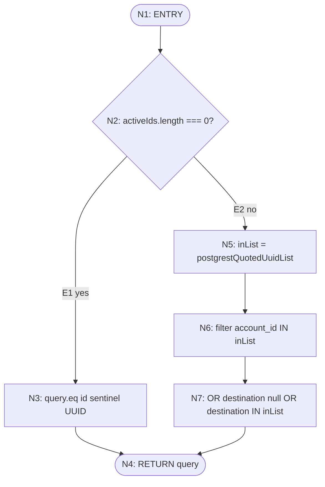
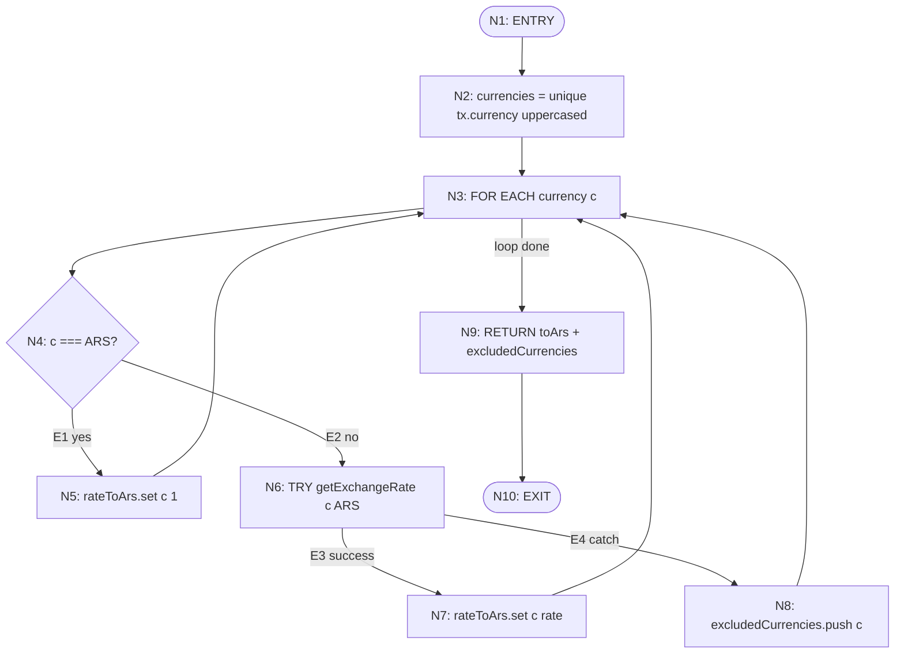
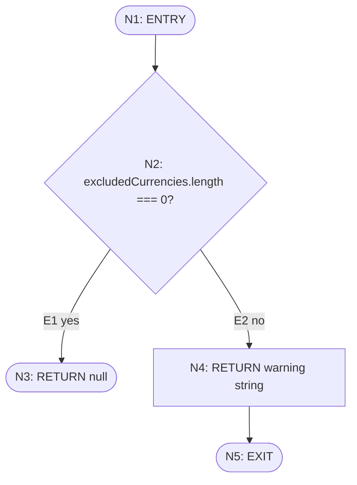
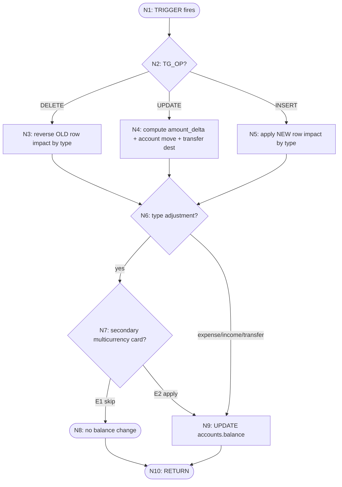

# test-1 — CU-001 Control Flow Graphs

**Unit:** CU-001 — Register / list financial movements  
**Primary file:** `lib/services/transactions.ts`  
**Database trigger:** `update_account_balance()` in `supabase/schema.sql`

---

## 1. `applyArchivedAccountsTransactionFilter`

Pure filter applied before global transaction list queries when archived accounts must be excluded.

| Node / edge | Meaning |
|-------------|---------|
| N2 | Decision: no active accounts |
| E1 | Empty active set → impossible id filter (returns zero rows) |
| E2 | Non-empty → include only movements touching active accounts |
| E3 | UUID quoting inside `postgrestQuotedUuidList` (embedded in N5) |

---

## 2. `buildToArsConverter`

Builds a per-transaction ARS converter for dashboard / cron summaries.

---

## 3. `excludedCurrenciesNote`

User-facing note when some currencies lacked a live quote.

---

## 4. `update_account_balance()` (PL/pgSQL)

Postgres trigger maintaining `accounts.balance` on `INSERT | UPDATE | DELETE` of `transactions`. Simplified CFG (top level):

**Evidence type:** schema review + production functional tests CP-001-01/03 (saldo observado antes/después). Not executed by Vitest (requires Postgres).

**Key branches inside DELETE/INSERT arms:**

| Branch | Effect |
|--------|--------|
| `expense` | Debit source account |
| `income` | Credit source account |
| `transfer` | Debit source; credit destination if present |
| `adjustment` + not secondary | Apply signed delta |
| `adjustment` + secondary multicurrency | Skip primary balance (RN tarjeta bimonetaria) |

Full source: `supabase/schema.sql` lines 449–586.
