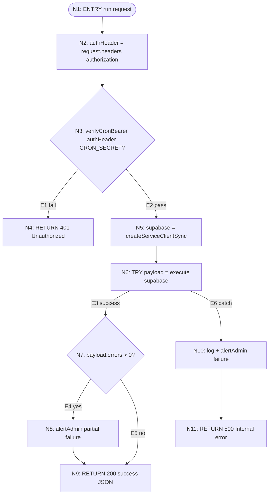
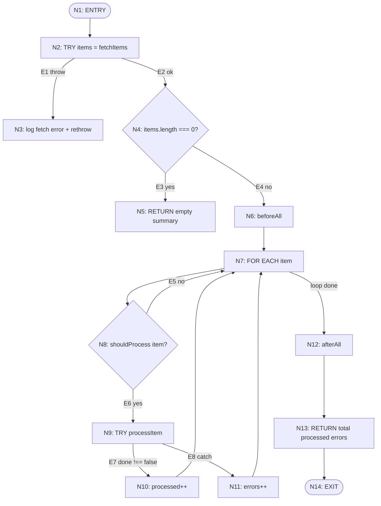
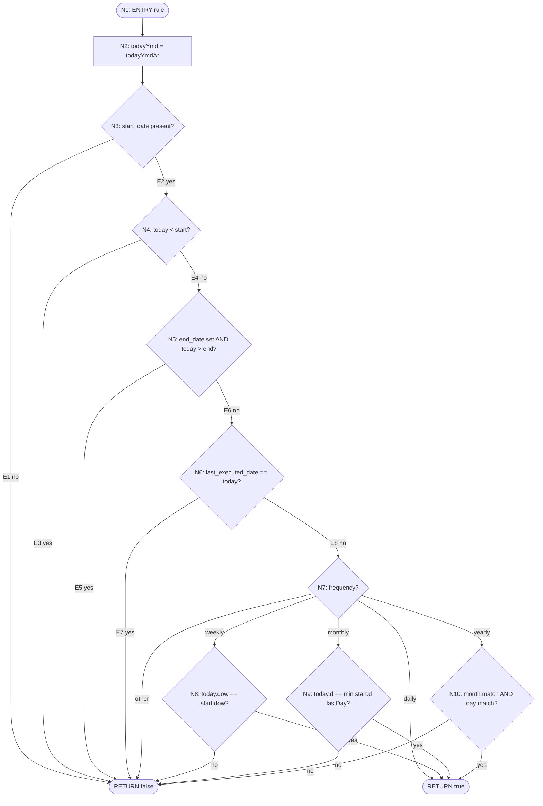

# test-1 — CU-006 Control Flow Graphs

**Unit:** CU-006 — Execute recurring rules (Vercel Cron)  
**Files:** `lib/cron/cron-job.ts`, `lib/cron/recurring-schedule.ts`, `app/api/cron/recurring/route.ts`

---

## 1. `CronJob.run` (Template Method)

---

## 2. `IterativeCronJob.execute`

Batch template used by `RecurringRulesJob` and other crons.

---

## 3. `shouldExecuteToday`

Pure scheduler extracted to `lib/cron/recurring-schedule.ts` (used by `RecurringRulesJob.shouldProcess`).

---

## 4. `RecurringRulesJob` (route handler — reference only)

`app/api/cron/recurring/route.ts` wires `GET → RecurringRulesJob.run`. Its `processItem` performs Supabase claim + `transactionsService.create` + optional Telegram DM. **Not unit-tested** (I/O); scheduling branches are covered via §3.
